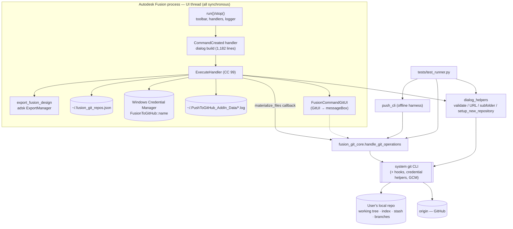
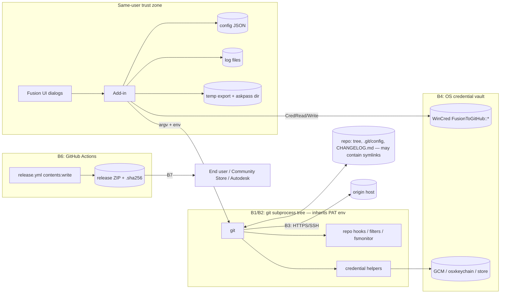
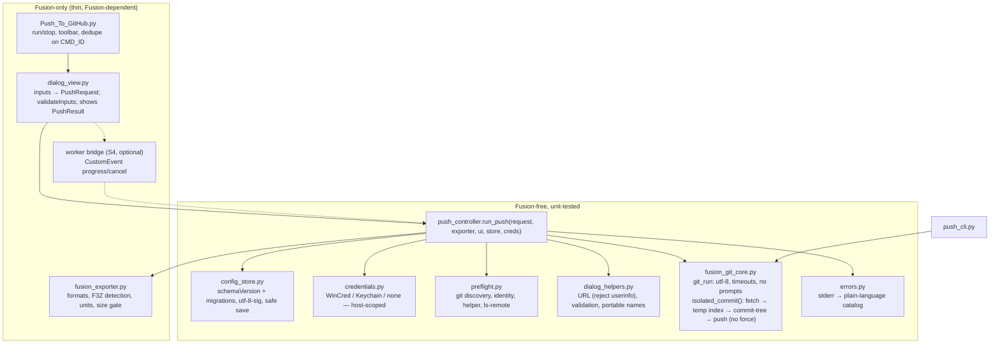
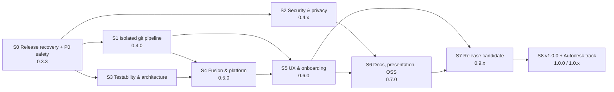

# FusionToGitHub — v1.0 Release Readiness Audit

| | |
|---|---|
| Repository | `zcohen-nerd/FusionToGitHub` |
| Audited state | branch `release/0.3.2`, HEAD `29a5c17537f4e97936ae223a561ccb14d796402a`, clean working tree |
| Audit date / research date | 2026-11-26 |
| Mode | Read-only investigation. No tracked file, commit, tag, release, branch, setting or git config was changed. All experiments ran in disposable repositories with an isolated git configuration and fake tokens. |
| Method | Primary reviewer plus seven parallel workstreams (Git/data integrity; security/privacy; Fusion API + platform + UX; architecture/quality/testing; release engineering + Community Store; Autodesk App Store research; docs/OSS/branding). The primary reviewer reconciled the results and spot-checked the key defects against source. |
| Annexes | `annexes/ANNEX-3_Fusion_Platform_UX_workpaper.md` and `annexes/ANNEX-7_Docs_OSS_Branding_workpaper.md` hold the two longest workstream reports, including the full manual Fusion acceptance procedure and the documentation inventory. Everything material from the other five workstreams is consolidated in this report. |

---

## A. Executive Summary

**Maturity.** FusionToGitHub is a functional **0.3-level product**:
- On the happy path, on Windows, for a single user, it exports the active design and pushes it to GitHub reliably.
- It has a clean dependency structure: a Fusion layer over a Fusion-free git core.
- It has zero third-party runtime dependencies and a careful credential design.
- It has a good set of local-bare-remote integration tests (19/19 pass).

It is **not ready for a stable v1.0**, and it is **not ready for broad marketplace distribution in its current state**.

**Most significant findings.**

1. **The current public release is broken (P0).**
   - GitHub release `0.3.2` is published as *Latest* with **no assets**.
   - Its tag points to an unmerged branch whose manifest still says `0.3.1`.
   - The packaging workflow refused to run, but only *after* publication. Nothing gates a release before it becomes public.
   - A stale, hand-built ZIP is also committed to the repository root.
   - No release in the project's history has ever carried an installable asset. The Community Store therefore cannot install the add-in.

2. **Data integrity is the weakest dimension.** The pipeline runs inside the user's own working tree, index, branch and stash. Experiments in disposable repositories confirmed that it can:
   - force-push over a colleague's remote commits. `--force-with-lease` is defeated by the tool's own fetch, and in one configuration this happens **without any prompt** because "Force Push" is persisted per repo.
   - rebase and rewrite the user's own local branch before every export.
   - publish the user's unpushed and possibly private commits inside every snapshot branch.
   - pop the **wrong (stale) stash**, or lose track of the user's stash entirely when git output contains non-ASCII text on Windows.
   - report "✅ … restored" when restoring the stash actually failed with conflicts. The CLI exits 0 in that case.
   - leave staged and overwritten files on the user's branch when a hook or commit fails.

3. **The documented first-run path fails.** "Set up new…" with a blank name (which the README invites) clones to one folder and saves another into the config. The first push fails and cannot be fixed from the UI. This was confirmed by driving the real handlers through a fake `adsk` harness. The install docs also tell users to create a folder (`FusionToGitHub`) that does not match the add-in files (`Push_To_GitHub.*`). Autodesk's naming rule requires them to match.

4. **The snapshot-branch model hides results from novices:**
   - After a push the exported files *disappear* from the local folder, because the original branch is checked back out.
   - `main` is never pushed when the remote starts empty.
   - The "automatic changelog" never accumulates.
   - Merging any two snapshots always conflicts.

   This is a product-design issue rather than a defect, and it needs a maintainer decision (§Q).

5. **Fusion integration risks** (all need live Fusion to confirm):
   - Every git network operation, including browser sign-in, runs synchronously on Fusion's UI thread with no timeout and no cancel.
   - Designs with linked components may produce an unrestorable `.f3d` (Fusion requires `.f3z` for external references).
   - The STEP AP203/AP214 option is a silent no-op.
   - The toolbar control is created with its ID passed as a *position* ID.

6. **macOS** has no reliable git discovery and no supported credential path without extra installs. It should be labelled *experimental* until it is tested.

7. **Marketplace blockers.**
   - The add-in icon embeds GitHub's Invertocat. GitHub's logo policy prohibits that.
   - There is no privacy policy.
   - For the Autodesk App Store there is no compatible End User Agreement: Autodesk's default agreement conflicts with MIT.
   - The docs contradict each other on install location and product naming.

**Strengths to preserve.**
- Only named paths are staged (never `git add -A`).
- Exports are materialized only after the branch exists, so the stash never swallows them.
- A failed push is never reported as success.
- A conflicted rebase is always aborted.
- The askpass helper keeps the token off disk.
- Every subprocess uses a list of arguments (no shell).
- URL schemes are restricted, and export-subfolder containment is checked.
- Config writes are atomic.
- CI actions are pinned by SHA and updated by Dependabot.
- The test suite is honest and uses bare remotes.
- SECURITY.md is unusually candid.
- The README's plain-language tone is right.
- DiegoV71's contribution of a stable manifest GUID and correct ZIP layout fixed the main Community Store compatibility gaps.

**Recommended direction.**
1. **Immediately:** withdraw 0.3.2 (mark it prerelease with a note; do not move the tag). Fix the release gate and ship **0.3.3** with the P0 set (Sprint S0).
2. **Then:** rebuild the commit path so it never touches the user's checkout. Commit on top of the fetched remote tip using a temporary index, push without force, and make "force push" unnecessary (Sprint S1). This one change removes most of the data-integrity findings.
3. **In parallel:** harden security and privacy, make the add-in layer testable, add timeouts and platform work, and simplify the UX around a single-history default.
4. Validate natively in Fusion on Windows and macOS, then release 1.0.0.

Estimated remaining effort to v1.0 is roughly **50–75 focused engineering days**. Submission to the Autodesk App Store should follow v1.0 as a separate track, after Autodesk answers the open questions in §J.

**Go / no-go summary.**

| Decision | Recommendation |
|---|---|
| Continued development | **GO** |
| GitHub public distribution | **Conditional GO.** Withdraw 0.3.2 now. Ship 0.3.3 only after Sprint S0, labelled "pre-1.0, Windows-first, macOS experimental". |
| Community Store distribution | **NO-GO today** (no installable asset exists). **Conditional GO at 0.3.3** as a pre-1.0 listing. File the trusted-source request after 0.4.0 (data-integrity hardening). |
| Autodesk App Store submission | **NO-GO.** Needs v1.0 quality, a privacy policy, an End User Agreement, an original icon, store assets and answers from Autodesk. |
| Stable v1.0.0 | **NO-GO.** Achievable after Sprints S0–S7. |

---

## B. Repository Baseline

### Git and GitHub state (verified)

| Item | Value |
|---|---|
| Current branch / SHA | `release/0.3.2` @ `29a5c17` ("Add automated release packaging workflow"); tracked tree clean. Pre-existing ignored items: `.ruff_cache/`, `src/__pycache__/`. |
| Other branches | `main` (@ `bd89fa3`, merge of PR #12); `origin/release/0.3.2` |
| Tags | `0.3` → `a06f3b7`; `0.3.1` → `939f5dc`; `0.3.2` → `29a5c17` (lightweight; **not on `main`**) |
| Releases | `0.3.2` (Latest, published 2026-11-26 13:52 UTC, target `release/0.3.2`, empty body, **0 assets**); `0.3.1` (2026-08-31, 0 assets); `Version 0.3` (2025-03-31, 0 assets) |
| Latest release workflow run | `Release Packaging` #45833326393 **failed**: "Release tag 0.3.2 does not match manifest 0.3.1" |
| Open PRs | #13 "Create Push_To_GitHub-universal.zip" (release/0.3.2 → main; adds release.yml, .gitignore entries and the binary ZIP; empty description; CI green) |
| Recent merged PRs | #12 (DiegoV71 / Pavel Kuznetsov: manifest `id` GUID and README packaging section, merged 2026-11-26); #10/#8 Dependabot; #7 SHA pinning; #5 0.3.1 version unification; #2–#4 earlier audit fixes |
| Issues | #11 "Provide an installable Push_To_GitHub release ZIP" (closed; maintainer acknowledged) |
| Repo settings observed | Public; default workflow token permission `read`; secret scanning and push protection on; **private vulnerability reporting off**; immutable releases off; SHA-pinning enforcement off; one ruleset on the default branch (no deletion, no non-fast-forward); no tag ruleset; topic `fusion360-addin` present |
| Community profile | 57%. No CONTRIBUTING, CODE_OF_CONDUCT, issue or PR templates. |

### Version surfaces

| Surface | Value |
|---|---|
| `src/Push_To_GitHub.manifest` | `0.3.1` |
| `fusion_git_core.VERSION` | `0.3.1` (declared single source of truth in CHANGELOG) |
| CLI `--version` | `0.3.1` |
| README | `0.3.1` |
| CHANGELOG | top entry `0.3.1`; no 0.3.2 entry |
| Test runner banners | hard-coded `0.3.1` |
| Git tag / release | `0.3.2` |

### Structure (38 tracked files)

- `src/`
  - `Push_To_GitHub.py`: 2,196 lines, 1,295 statements. Fusion entry point, dialog, export, config, Windows Credential Manager, identity.
  - `fusion_git_core.py`: 562 lines. Shared git pipeline.
  - `dialog_helpers.py`: 337 lines. URL, validation, subfolders, repo setup.
  - `push_cli.py`: 217 lines. Offline CLI harness.
  - `diagnostic.py`: 111 lines.
  - `Push_To_GitHub.manifest`.
  - `AddInIcon.svg`: 75 KB; a base64 PNG wrapped in SVG.
- `tests/`: `test_runner.py` (1,156 lines, 19 automated tests), `TESTING.md`, `MANUAL_TESTS.md`, `TEST_FRAMEWORK_SUMMARY.md`.
- `.github/`: `workflows/ci.yml`, `workflows/release.yml`, `dependabot.yml`, `scripts/check-docs.mjs`, two Copilot agent files, one prompt file.
- Docs: `README.md`, `CHANGELOG.md`, `SECURITY.md`, `INSTALL_QUICK.md`, `REFACTORING_SUMMARY.md`, `TROUBLESHOOTING_CRASHES.md`, `milestones.md`, and `docs/*` (8 files). About 4,800 lines of Markdown in total.
- Root: `LICENSE` (MIT, "2025 Zac Cohen"), `requirements.txt` (no dependencies), `ruff.toml`, `.gitignore`, **`Push_To_GitHub-universal.zip`** (tracked even though it is listed in `.gitignore`).

### Capabilities as claimed vs. verified

| Claimed capability | Verified status |
|---|---|
| Export F3D, STEP, STL, IGES, SAT | **Implemented** with the documented ExportManager APIs. `execute()` result and file size are checked. The STEP protocol option is a no-op. F3Z/xref handling is unverified. IGES/SAT may be blocked on the Personal Use licence tier. |
| Git commits and snapshot branches | **Implemented.** One branch per export, forked from the user's current HEAD. |
| Push to GitHub | **Implemented** through the system git CLI. Any https/ssh host whose URL ends in `.git` is accepted. |
| Automatic changelogs | **Partially true.** Each snapshot branch gets a `CHANGELOG.md` holding only its own new entry. It never accumulates on `main`. |
| Multiple repository configurations | **Implemented** (`~/.fusion_git_repos.json`). There is no edit or remove UI and no schema version. |
| Preserving local changes | **Implemented with defects:** wrong-stash pop, stash stranding, false "restored" message, staged state lost, and the user's branch is rebased. |
| Git-based authentication | **Implemented** through Git Credential Manager (Windows) or an optional PAT via askpass. macOS has no supported path without extra installs. |
| Windows Credential Manager storage | **Implemented** (ctypes `CredWriteW` / `CredReadW` / `CredDeleteW`). Windows only. Git's own credential helpers can also copy the token (§F SEC-02). |
| Fusion-independent CLI and test harness | **Implemented.** The CLI and tests exercise the *same* core pipeline the add-in uses. The add-in layer itself has 0% automated coverage. |

### Supported environments (as defined)

- **Manifest:** `supportedOS: windows|mac`.
- **Fusion version:** no minimum version or tested build is recorded anywhere.
- **Python:** CI covers 3.10–3.12 on ubuntu and windows. The Python version bundled with Fusion is not pinned or verified.
- **Testing:** no macOS CI, and no recorded manual Fusion test results.

### Existing architectural decisions

- A Fusion-free core behind a `GitUI` Protocol.
- A `materialize_files` callback so exports enter the tree only after the stash and branch steps.
- The snapshot-branch-per-export model.
- `LC_ALL=C` for locale-proof parsing of git messages.
- Askpass with environment-only secrets.
- A frozen `CMD_ID` to preserve toolbar placement.
- `fusion_git_core.VERSION` as the single source of truth for the version.

---

## C. Review Coverage

### First-party files reviewed

| File / group | Reviewed by | Depth |
|---|---|---|
| `src/Push_To_GitHub.py` | Git, Security, Fusion/UX, Architecture (each read it in full) + primary spot-checks | Line-by-line |
| `src/fusion_git_core.py` | Primary (full), Git, Security, Architecture | Line-by-line, plus experiments |
| `src/dialog_helpers.py`, `push_cli.py`, `diagnostic.py`, manifest | Git, Security, Fusion/UX, Architecture | Line-by-line |
| `src/AddInIcon.svg` | Fusion/UX, Docs, ADSK | Structure inspected; embedded PNG decoded and viewed |
| `tests/test_runner.py` + `tests/*.md` | Architecture (full), Git, Docs | Line-by-line, plus coverage run |
| `.github/workflows/*.yml`, `dependabot.yml`, `scripts/check-docs.mjs` | Release, Security, primary | Line-by-line, plus local replication of the build |
| `.github/agents/*`, `.github/prompts/*` | Security, Docs | Read |
| All Markdown docs, `LICENSE` | Docs (full), with cross-checks by Security, Fusion/UX, Release | Claims verified against code |
| `.gitignore`, `ruff.toml`, `requirements.txt` | Primary, Release | Read |
| `Push_To_GitHub-universal.zip` (binary) | Primary, Release, Security | Contents listed and diffed against `HEAD:src`. Not reviewed line-by-line: it is a build artifact. |

**Excluded from line-by-line review:** `.ruff_cache/` and `src/__pycache__/` (ignored generated files). The external `4FusionLab/CommunityStore` code was read at `fab5c7a8` to extract its requirements. It was **not executed**.

### Tools executed (actual)

| Tool / command | Result |
|---|---|
| `python tests/test_runner.py` (primary; Python 3.14.7, git 2.51.0.windows.1) | 19/19 pass, 34.9 s |
| Same suite, isolated (`GIT_CONFIG_GLOBAL=<scratch>`, `GIT_CONFIG_NOSYSTEM=1`), by Architecture / Security / Git | 19/19 pass (27.3 s) each time |
| Same suite at tag `0.3.2` in a scratch clone (Release) | 19/19 pass |
| Same suite with a hostile global config (`commit.gpgsign=true`) | **9/19 fail**: the tests inherit the user's git config |
| `python -m ruff check src tests` (pinned rule set E4/E7/E9/F) | Pass |
| `ruff --select ALL --statistics` | Mostly style. Notable: 43 BLE001 blind-except, 15 global statements, 14 C901, 9 S603, 6 PLW1510 |
| `node .github/scripts/check-docs.mjs` | Pass. 21 files, 14 external URLs, 1 warning (github.com/signup returned 403) |
| `coverage run` (branch) | Total 18%. `Push_To_GitHub.py` 0%, `fusion_git_core` 61%, `dialog_helpers` 46%, `push_cli` 68% (subprocess), `diagnostic` 0% |
| Fake-`adsk` harness (scratch, about 250 lines) | Drives the real dialog and execute handlers; reaches 49% of `Push_To_GitHub.py`; found BUG-01 and REL-13 |
| `radon cc` / `mi` | `ExecuteHandler.notify` CC **99**, 486 lines; `InputChangedHandler._handle` 38; `run` 34; `handle_git_operations` 29; MI of `Push_To_GitHub.py` = C |
| pyright 1.1.400 | 60 errors (46 are "adsk possibly unbound" from the import guard) |
| mypy 2.4.1 | 1 error in default mode (`fusion_git_core.py:271`, `str \| None`); 12 under `--strict` |
| vulture | Mostly false positives. Real hits: unused `DEFAULT_*` constants, vestigial `GitUI.info`, `file_abs_paths_to_add` |
| Git experiments E1–E23 | See §E |
| Security experiments E1–E8 (local HTTP git server with Basic auth) | See §E |
| Packaging replication and negative tests | See §E |
| Read-only `gh` queries | Releases, runs, PRs, issues, settings, community profile, PVR status |

### Review limitations

- **No Autodesk Fusion installation was available.** Every runtime claim about Fusion is marked *unverified*, and a manual procedure is provided (§M and Annex 3 §6).
- **No macOS machine was available.** macOS findings are drawn from code and platform documentation.
- Git Credential Manager was deliberately not exercised, to avoid touching the real Windows credential vault. Its behaviour is inferred from git's documented helper protocol and from experiments with the `store` helper.
- No network tests were run against github.com. Default-branch selection on an empty remote and the 100 MB rejection rely on GitHub's documentation.
- Some Autodesk pages could not be fetched: the trademark guidelines (403) and the icon-guidelines ZIP (403). The Standard End User Agreement PDF uses an encoded font, so its text was reconstructed and quotes are approximate.
- The Python version bundled with Fusion and its default text encoding are unverified. This determines how severe REL-03 is.

---

## D. Current System Architecture

### Components

| Component | Responsibility | Notes |
|---|---|---|
| `Push_To_GitHub.run/stop` | Toolbar command, handlers, logging setup | `addCommand(def, CONTROL_ID)` misuses positionID (BUG-07) |
| `GitCommandCreatedEventHandler.notify` (1,182 lines) | Builds the dialog; nested `InputChangedHandler`, `ExecuteHandler` | God-handler (ARCH-02) |
| `ExecuteHandler.notify` (CC 99) | Validate → identity → new-repo setup → save config → export → materialize → pipeline → summary | Contains BUG-01 |
| `export_fusion_design` | adsk ExportManager calls into a temp dir | Checks `execute()` and size |
| Config store (inline) | `~/.fusion_git_repos.json` (flat dict plus `__meta__`), atomic write | No schema version |
| Credential store (inline ctypes) | `FusionToGitHub::<display name>` in Windows Credential Manager | Windows only |
| `ensure_git_identity` | Prompts for name and email; writes `git config --global` | Global side effect |
| `dialog_helpers` | URL normalization and validation, subfolder rules, `setup_new_repository` | Takes git as an injected function |
| `fusion_git_core.handle_git_operations` | stash → pull --rebase → branch → materialize → CHANGELOG → add → commit → push → restore | Shared by the add-in and CLI |
| `git_run` | `subprocess.run([GIT_EXE,…], text=True)` with `LC_ALL=C` | No timeout, no encoding, no `stdin=DEVNULL` |
| `push_cli` | Terminal UI adapter for offline testing | Also shipped in the release ZIP |



### Export and publication control flow (as implemented)

```mermaid
sequenceDiagram
  participant U as User
  participant X as ExecuteHandler (UI thread)
  participant F as Fusion ExportManager
  participant C as fusion_git_core
  participant G as git (user's checkout)
  participant O as origin
  U->>X: OK
  X->>X: validate inputs, check git, ensure identity (may write --global)
  opt "Set up new…"
    X->>G: clone / init + remote + empty commit (no progress UI)
  end
  X->>X: save config (incl. sticky skipPullDefault)
  X->>F: export each format → temp dir
  X->>C: handle_git_operations(materialize_files)
  C->>G: status → stash push -u (if dirty, confirm)
  C->>G: pull --rebase origin <USER BRANCH>  (rewrites user branch)
  alt pull fails
    C->>G: rebase --abort
    C->>U: "force-push instead?" (offered for ANY failure)
  end
  C->>G: checkout -b fusion-export/<name>-<ts> (from user HEAD)
  C->>G: copy exports; prepend CHANGELOG.md; add <paths>; commit
  C->>O: push [--force-with-lease] -u origin <branch>
  C->>G: finally: checkout original; stash pop (first entry matching fixed message)
  C-->>X: result (built BEFORE restore outcome is known)
  X->>U: "✅ Push successful … restored" (even if pop conflicted)
```

### Data flows and storage

| Data | Source | Stored | Transmitted |
|---|---|---|---|
| Design exports (.f3d full parametric history, STEP/IGES/SAT/STL) | Fusion | temp dir (deleted), then repo history | to `origin` on push |
| Design name, commit message, timestamps, git name/email, timezone | User, Fusion, git config | commits, branch names, CHANGELOG.md, config | to `origin` |
| Repo URL, local path, settings, last message | User | `~/.fusion_git_repos.json` (+ `.tmp`, `.bak_corrupted_*`) | not by the add-in |
| PAT (optional, Windows) | User (visible input) | Windows Credential Manager; process environment of git children; **possibly git credential-helper stores** | to `origin` host via HTTPS Basic auth |
| Logs | Add-in | `~/.PushToGitHub_AddIn_Data/PushToGitHub.log` ×4 (1 MB rotating) and the Fusion Text Commands window | not sent. SECURITY.md advises attaching the log to public issues; it can hold paths, usernames and any token embedded in a URL. |
| Telemetry | none | — | — |

### Trust boundaries



**Architecture assessment.**
- **Dependency direction is clean and acyclic** (Fusion layer → helpers/core → stdlib).
- **Git logic is not duplicated.** The add-in really does use the tested pipeline.
- **The main structural problems are these:**
  1. The pipeline operates on the user's live checkout. This is the root cause of most REL findings.
  2. The add-in orchestration is a single CC-99 handler that cannot be imported outside Fusion, which explains its 0% coverage and the BUG-01 class of defects.
  3. All work runs synchronously on the UI thread.
  4. There is no config schema or versioning.
  5. Module-level globals (15 `global` statements) are acceptable for a Fusion add-in, but should be confined to the thin Fusion layer.

---

## E. Verification Results

### Automated tests and static analysis

See §C for the commands. Summary:
- The 19 automated tests pass on Windows, Python 3.14.7, git 2.51. CI is green on ubuntu and windows with Python 3.10–3.12.
- Configured lint passes, and so does the docs check.
- The tests are **not isolated from the user's git configuration**: 9 of 19 fail when `commit.gpgsign=true` is set globally. Each run also leaks about 9 temp repositories into `%TEMP%` on Windows.
- **No test would have caught the 0.3.2 version mismatch.** T_VERSION compares the internal surfaces only with each other, never against the tag.

### Investigative experiments

All experiments used disposable repositories with local bare remotes, and `HOME`/`GIT_CONFIG_GLOBAL` redirected.

| ID | Scenario | Observed result | Finding |
|---|---|---|---|
| G-E1 | Pre-existing user stashes; staged, unstaged, untracked and ignored changes | User stashes preserved; export commit contains only CHANGELOG + export. **Staged state lost on restore** (`M ` became ` M`). | REL-14 |
| G-E2 | Remote advanced and the user has edits to the same file | `pull --rebase` fast-forwards the user's branch; stash pop **conflicts** (`UU`). UI shows success "auto-stashed… and restored". | REL-04, REL-05 |
| G-E3 | Failing pre-commit hook | User's branch left with `A CHANGELOG.md`, `M model.step` (overwritten), plus an orphan empty export branch | REL-07 |
| G-E4 / E23 | Start in detached HEAD | Ends on `main`; stash conflict; export based on the wrong commit. With no main/master: "back on 'None'" message. | REL-08 |
| G-E5 | Feature branch with an unpushed "private" commit | **The private commit and `secret.txt` were published** in the snapshot branch | SEC-01 |
| G-E6 | Unpushed merge commit on main | User's main **linearized and rewritten** (new SHAs, merge removed) | REL-05 |
| G-E7 / E7b | Push rejected; force without a tracking ref | Reported as failure (correct); lease rejected "stale info" (correct) | strength |
| G-E7c | "Force Push" checked + override to a branch that exists only on the remote, after a fetch | **A colleague's remote commit was overwritten with no prompt** | REL-01 |
| G-E7d′ | Reused branch, sync fails, user confirms force | The tool's own fetch refreshed the lease; **the colleague's commit was overwritten** | REL-01 |
| G-E8b | Dirty submodule (nothing stashable) plus a stale earlier autostash | **The stale stash was applied and dropped**; working file became "STALE" | REL-02 |
| G-E9 | Locked untracked file (Windows) | `stash push -u` fails but leaves a stash entry; run fails; stash never mentioned | REL-02 |
| G-E10 | User mid-`rebase -i` | Pipeline ran; the user's amended commit was orphaned (reflog only) | REL-09 |
| G-E11 / E13 | Ignored export path; non-UTF-8 CHANGELOG | Failure with residue left on the user's branch | REL-07 |
| G-E12 / E16 | Non-ASCII stash message or branch output (cp1252 locale) | `UnicodeDecodeError` swallowed in subprocess's reader thread, `stdout=None`; **"Auto-stash entry not found"** (logged only); user's work stranded; UI says restored | REL-03 |
| G-E14 | LF CHANGELOG on Windows | Rewritten as CRLF | REL-12 |
| G-E15 | Merge two snapshot branches | add/add conflicts in CHANGELOG.md and the export; one entry per branch | UX-01 |
| G-E17a–c | "Set up new" on an existing repo; non-empty folder + non-empty remote; empty remote | origin silently re-pointed; unrelated histories; `main` never pushed | REL-10, UX-01 |
| G-E18 | Stale `index.lock` | Presented as "pull failed… force-push instead?" | UX-04 |
| G-E19 | 6 s pre-push hook | Call blocked for 8.2 s (no timeout) | REL-06 |
| G-E20 / S-E3 | Hook during commit | Hook printed the fake PAT and askpass path | SEC-04 |
| G-E21 | CLI end-to-end with pop conflict | rc=0, "auto-stashed and restored", tree `UU` | REL-04 |
| G-E22 / E22b | Override "main"; invalid ref names | Committed and pushed directly to `main`; invalid names fail late | UX-09, BUG-08 |
| S-E1 | Token embedded in URL | Accepted as "✅ valid"; leaked to error text, log and `.git/config` | SEC-03 |
| S-E2 / E2b / E2c / E8 | Stored-PAT push with a `store` credential helper; stale helper credential; proposed fix | Token **persisted in plaintext** by the helper; a stale helper credential **overrides** the stored PAT and the failure is offered as "force-push"; the host-scoped inline-helper fix persists nothing and fails closed | SEC-02 |
| S-E4 / E6 | Design named `-n`; branch `--force`; `a..b`, `x.lock` | Parsed as git options; invalid refs pass sanitization (fail safely, late) | BUG-08 |
| S-E5 / E5b | Junction subfolder; symlinked CHANGELOG.md | Export written outside the repo; an outside file prepended with changelog text | SEC-05 |
| S-E7 / R-exp | `git archive HEAD:src` twice | Different SHA-256 values; no commit ID embedded; LICENSE read from the working tree; CRLF on Windows builds. `--mtime` makes the build reproducible. | SEC-06 |
| R-neg | Validator negative tests | **Passed** packages with: an unpackaged imported module, a syntax error, `id:"not-a-guid"`, `version:"banana"`, missing `type`/`autodeskProduct`, an extra file | PKG-03 |
| A-S3 | Fake-adsk: new repo, blank name, suggested folder | Clone at the derived path; config saved with `…\NewRepo`; push fails "not a Git repo"; retry fails "Path does not exist" | BUG-01 |
| A-S4 | Config with a UTF-8 BOM | Treated as corrupt and reset to `{}` (backup made) | REL-13 |
| A-perf | 1 KB push with 0, 1,000 and 5,000 branches; 60 MB binary | 2.18 s / 2.2–2.65 s / 3.4 s; 60 MB: 5.1 s locally; 12 git processes per push; `.git/config` grows by one `[branch]` section per push (495 KB at 5,000) | PERF-02 |
| F-regex | `_safe_base` on "Air valve", "Shelf vertical", "Tool vA" | Became "Air", "Shelf", "Tool" | BUG-06 |

### Primary reviewer spot-checks (source confirmed)

| Finding | Confirmed in source |
|---|---|
| BUG-01 | `Push_To_GitHub.py:1636-1642` recomputes `local_path`; the entry is saved at `:1691`; `:1730` overwrites it with `normalized_repo_path` |
| BUG-07 | `:2098` `addCommand(push_cmd_def, CONTROL_ID)` |
| BUG-09 | `:2129`, `:2156` use `CriticalLogLevel`; `:1836` uses `isBackgroundTranslucencyEnabled` |
| BUG-03 | `:812` `hasattr(opts, "applicationProtocol")` |
| REL-01 | `:1264` and `:1777` persist `skipPullDefault` |
| REL-05 | `fusion_git_core.py:271` pulls the original branch |
| REL-02 | `:234-235` and `:515-519` stash identity by message |
| REL-06 | `:60-67` `subprocess.run` without a timeout |

---

## F. Detailed Findings

### F.1 Conventions

**Finding IDs** are consolidated: each ID is a classification prefix plus a number. The "Src" field names the workstream IDs each finding merges. Source prefixes:

| Prefix | Workstream |
|---|---|
| GIT | Git / data integrity |
| S | Security |
| FUS, PLAT, UX | Fusion integration, platform, UX |
| ARCH, QUAL, TEST, PERF | Architecture, code quality, tests, performance |
| PKG, CS | Release / Community Store |
| ADSK | Autodesk App Store |
| DOC, OSS, BRAND | Documentation, OSS process, branding |

**Severity:** Critical, High, Medium, Low, Info.

**Release priority:**
- P0: before further distribution.
- P1: before v1.0.
- P2: strongly recommended before v1.0.
- P3: after v1.0.
- P4: optional.

**Evidence status:**
- **C** (confirmed): reproduced, or verified directly in source or docs.
- **S** (suspected).
- **U** (unverified): needs live Fusion, macOS, or GitHub.com.

**Effort:**
- XS: under 2 h.
- S: up to 1 day.
- M: 1–3 days.
- L: more than 3 days.

### F.2 Reconciliation of disagreements between workstreams

| Topic | Disagreement | Resolution and evidence |
|---|---|---|
| Release workflow quality | Docs said it was "well designed; failed only because version not bumped". Release said the gate runs after publication and the validator is weak. | **Release is correct.** The validator passed 5 invalid packages, and the version gate fires only on `release: published`, so a broken release is always public before the check runs. The workflow's *structure* (SHA pins, env-passed tag, ZIP prefix) is good; its *gating* is not. |
| SECURITY.md accuracy | Docs called it "accurate against code". Security found claims C9, C10, C11 and C4 inaccurate. | **Security is correct**, backed by experiments S-E2 and S-E3: the token is in every git child's environment, helpers persist it, and helpers take precedence over askpass. SECURITY.md is still the best document in the repo. |
| 0.3.2 remediation | Security suggested "bump and re-run, or delete/re-create". Docs and Release suggested superseding with 0.3.3. | **Supersede with 0.3.3.** A re-run uses the tagged SHA (which still says 0.3.1), so it cannot succeed without moving a public tag. Moving it would contradict the project's stated immutable-tag policy (CHANGELOG). |
| Recommended history model | UX suggested "single history: pull --rebase, then commit to the configured branch". Git warned that running pull --rebase on the user's branch is the defect. | **Adopt Git's mechanism with UX's target.** Build the commit with a temporary index on top of the *fetched remote tip* of the target branch (default `main`, per-design folder). Never touch the user's checkout, never rebase, never force. |
| Threading | Fusion/UX proposed a worker thread with CustomEvent now. Architecture proposed timeouts first and threading only if measured. | **Do both, in sequence.** Mandatory timeouts, `stdin=DEVNULL` and prompt suppression go in S1. A worker thread for the *network phase only* goes in S4 if the live Fusion test shows "Not Responding" during sign-in or push (decision Q6). |
| Masked token input exists in Fusion | Security: unverified (doc URLs returned 404). ADSK: an official page found via search. | **Likely exists** (`StringValueCommandInput.isPassword`). Treat as high-medium confidence; confirm in Fusion's API reference during S2. |
| GCM vs askpass precedence | Git: unverified. Security: confirmed with the `store` helper. | Confirmed for git's helper protocol generally. GCM-specific behaviour should be checked manually (§M procedure M-SEC-1). |
| Install folder name breaks loading | Docs and UX: Medium-High confidence. ADSK: Autodesk rule verified. | Autodesk's own documentation says the folder, `.py` and `.manifest` names must match. Rated **High/P0**. Fusion's actual behaviour is still unverified, but the fix (point users to the release ZIP) is trivial either way. |

### F.3 Detailed findings: Critical and High

---

#### REL-01 — Force-push safety is ineffective; remote commits can be overwritten, in one configuration without any prompt

**Src:** GIT-06, UX-03, QUAL-05a, DOC-19, GIT-17
**Class / Sev / Pri:** REL · **Critical** · **P0** for the minimal mitigation, P1 for the full fix

**Files:**
- `fusion_git_core.py:271, 286-296, 354, 365-379, 448-452`
- `Push_To_GitHub.py:1159-1176, 1264, 1749, 1777`
- `README.md:14, 139, 197-198`

**Current behavior:**
- "Force Push (skip pull)" is a checkbox persisted per repo (`skipPullDefault`), so it silently applies to every later push.
- A failure of *any* `pull --rebase` (auth, network, `index.lock`, conflict) offers: "skip pulling and force-push this export instead?".
- Pushes use a bare `--force-with-lease`. Its expected value is the remote-tracking ref, which the tool's own `pull`/fetch (or a background fetcher such as GitHub Desktop) has just refreshed.
- Combined with a free-text branch override, this can overwrite any remote branch.

**Expected behavior:**
- Force is never persisted and never offered for auth, network or lock errors.
- Force is never used against the default branch or a branch the add-in does not own.
- The lease names an explicit expected SHA, captured before any fetch.
- The confirmation lists the commits that would be discarded.
- Ideally force is unnecessary by design (see ARCH target).

**Evidence (C):**
- G-E7c: "Force Push" checked, override `shared-export` (exists only on the remote), after a `git fetch`. The remote became `Design update ; seed`; the colleague's commit was gone; **no prompt appeared**.
- G-E7d′: the pull output `3ccbf5a..ce2de4f my-export -> origin/my-export` refreshed the lease; after the confirmed force, the colleague's commit was gone.
- Source confirmed at `Push_To_GitHub.py:1264, 1777`.

**Repro:**
1. Set up a bare remote with branch `X` holding a commit that is not local.
2. `git fetch`.
3. In the add-in, enable Force Push and set Branch Name Override to `X`.
4. Push. Commits on remote `X` are discarded.

**Root cause:** the lease semantics are misunderstood, force is persisted as a setting, and pull failures are not classified.

**Impact:**
- Irreversible loss of collaborators' work on the remote. Recovery needs another clone or GitHub support.
- It contradicts the README's "never rewrites or deletes" promise.

**Resolution:**
- **Minimal (S0):**
  1. Stop persisting `skipPullDefault`; ignore it when loading config.
  2. Refuse force when the target is the remote's default branch, or a branch not matching the add-in's prefix.
  3. Offer force only when the error is a non-fast-forward or conflict.
  4. Use `--force-with-lease=refs/heads/<b>:<sha-captured-before-fetch>` together with `--force-if-includes`.
- **Full (S1):** adopt the temp-index commit model (ARCH-05). Exports are full replacements committed on top of the fetched remote tip, so rejection is handled by re-fetch-and-rebuild and force becomes unnecessary. Remove the checkbox.

**Alternatives:** keep force for advanced users behind "type the branch name to confirm". This raises maintenance and documentation cost.

**Effort:** S (minimal) / M (full). **Depends on:** ARCH-05.

**Acceptance:**
- Automated tests reproduce E7c and E7d′ and the remote is unchanged.
- A reopened dialog shows force unchecked.
- An auth failure never offers force.
- Override to `main` with force is refused.

**Confidence:** High.

---

#### PKG-01 — Release 0.3.2 is public "Latest" with no assets, an empty body, and a version mismatch

**Src:** PKG-01, DOC-03, TEST-02 (partial), CS-04
**Class / Sev / Pri:** PKG · **High** · **P0**

**Files:**
- `src/Push_To_GitHub.manifest:9`
- `src/fusion_git_core.py:15`
- `.github/workflows/release.yml:3-5, 21-42`
- `CHANGELOG.md`

**Current behavior:**
- Tag `0.3.2` points at `29a5c17`, which exists only on `release/0.3.2`, and the code there reports `0.3.1`.
- The release was published and then packaging failed. It stays Latest with 0 assets.
- No release (0.3, 0.3.1, 0.3.2) has ever had an installable asset.

**Expected:** no public release unless the validated asset is attached and its manifest version equals the tag.

**Evidence (C):** `gh release view 0.3.2` shows `assets:[]`; run 45833326393 failed; reproduced locally.

**Impact:**
- Users get only GitHub's source ZIP, which needs manual restructuring.
- The Community Store has nothing to install.
- The add-in's reported version is wrong.

**Resolution:**
1. Edit release 0.3.2: set *prerelease*, which removes it from Latest and makes the Store ignore it. Add the body: "Withdrawn: packaging failed; contents report 0.3.1; superseded by 0.3.3."
2. Do **not** delete or move the tag.
3. Ship 0.3.3 through the fixed pipeline (PKG-02).
4. Add a "0.3.2 — withdrawn" CHANGELOG note.

**Alternatives:**
- Delete the release and tag, then re-cut. This rewrites a public tag and contradicts the stated policy.
- Hand-upload a ZIP. Rejected: it has no provenance and does not match the tagged source.

**Effort:** XS (withdraw) + S (re-cut). **Depends on:** PKG-02, PKG-05.

**Acceptance:**
- Latest = 0.3.3 with `Push_To_GitHub-0.3.3.zip`.
- The GitHub `digest` is present.
- The manifest inside the ZIP is 0.3.3.
- The release notes credit #11/#12.

**Confidence:** High.

---

#### PKG-02 — No pre-publication release gate

The CI is not required on the tagged commit, the tag is not checked before publish, CI does not run on tags or `release/*`, and T_VERSION ignores the tag.

**Src:** PKG-02, TEST-02, PKG-08, DOC-03
**Class / Sev / Pri:** PKG · **High** · **P0**

**Files:** `ci.yml:3-7`; `release.yml` (no `needs`); `tests/test_runner.py:140-182`; README:173-178 (which falsely claims CI enforces tag consistency).

**Current:**
- The release workflow triggers on `release: published` and validates afterwards.
- `workflow_dispatch` skips version validation.
- No CHANGELOG-heading check exists.
- There is no tag ruleset.

**Expected:**
- Tag push leads to reusable CI on the tag SHA, then `check_release --tag` (tag == manifest == VERSION == top CHANGELOG heading; tag SHA reachable from `main`), then build, then a *draft* release with assets, then a human smoke test, then publish.

**Evidence (C):** 0.3.2 itself; T_VERSION code; the suite passes at the mismatched tag.

**Resolution:**
- Convert `ci.yml` to `on: [push (main, release/**, tags), pull_request, workflow_call]`.
- `release.yml`: `on: push: tags`, with jobs `verify` (uses ci.yml) → `build` (contents: read) → `publish` (contents: write, environment `release` with a required reviewer) that creates a **draft**.
- Add `scripts/check_release.py`.
- Extend T_VERSION to cover the CHANGELOG heading and remove the hard-coded banners.
- Add a tag ruleset (no update or delete).
- Enable Immutable Releases.
- Correct README:173-178.

**Effort:** M. **Depends on:** PKG-03.

**Acceptance:** on a fork, a tag whose version doesn't match, or a red test, produces no public release; a correct tag produces a draft with assets.

**Confidence:** High.

---

#### PKG-03 — Package validation accepts broken packages

**Src:** PKG-03
**Class / Sev / Pri:** PKG/BUG · **High** · **P1** (part of S0)

**File:** `release.yml:62-103`

**Current:** the validator checks only required names, ZIP CRC, a truthy `id`, and the path prefix.

**Evidence (C):** six negative cases passed: a missing imported module, a syntax error, an invalid GUID, `version:"banana"`, missing `type`/`autodeskProduct`, and an extra file.

**Resolution:** add a single `scripts/package.py` used by both CI and local builds. It should:
- check the exact file set (equality, not superset);
- `py_compile` every module;
- AST-scan imports (stdlib, `adsk`, or packaged modules only);
- check that `uuid.UUID(id)` round-trips and equals the pinned constant;
- require the manifest keys, `type=="addin"`, `autodeskProduct∈{Fusion}`, and an allowed `supportedOS`;
- check that the version inside the ZIP equals the tag;
- mirror Community Store staging rules (folder == stem);
- run on every PR.

**Effort:** M.

**Acceptance:** all six negative cases fail and the real package passes.

**Confidence:** High.

---

#### BUG-01 — First-run "Set up new…" with a blank name and the suggested folder saves the wrong path; the first push fails and cannot be fixed in the UI

**Src:** QUAL-01
**Class / Sev / Pri:** BUG · **High** · **P0**

**Files:** `Push_To_GitHub.py:1636-1642, 1691-1704, 1730, 1791, 1827-1833`; README:88-89; MANUAL_TESTS Test 2.

**Current:**
- The repository is cloned to `~/FusionGitRepos/<derived-name>`.
- Line 1730 overwrites the saved path with the earlier validated placeholder (`…\NewRepo`).
- The push fails with "Path … is not a Git repo"; a retry fails with "Path does not exist".
- The path field is hidden for saved repos and there is no remove action, so recovery means hand-editing JSON.

**Expected:** the saved path equals the clone location and the first push succeeds.

**Evidence (C):**
- The fake-adsk harness scenario S3 drives the real handlers and shows the mismatch.
- With the name typed (S1), it succeeds.
- The source lines were confirmed by the primary reviewer.
- Not reproduced in live Fusion (U).

**Repro (Fusion):** Set up new… → paste a URL → leave Name blank, don't Browse → OK.

**Root cause:** the name is derived after validation, and the later "selected repo" path re-applies the stale validated path. The add-in layer is untested.

**Resolution:**
- After `setup_new_repository`, set `normalized_repo_path = local_path` (or derive the name and path in `inputChanged` before validation).
- Add a regression test with the fake adsk.
- Add an Edit/Remove repository action (ARCH-03).

**Effort:** S. **Depends on:** TEST-01 (for the test).

**Acceptance:** an automated blank-name + suggested-folder test pushes, and the config path equals the clone dir.

**Confidence:** High.

---

#### DOC-01 — Install instructions name the folder `FusionToGitHub`; the add-in files and package are `Push_To_GitHub`

**Src:** DOC-01, UX-01, ADSK-07, ADSK-F10, DOC-22
**Class / Sev / Pri:** DOC/PKG · **High** · **P0**

**Files:**
- README:50, 52-58
- INSTALL_QUICK:8-14
- GETTING_STARTED:43-55
- INSTALLATION:92-103, 238-242, 269-279, 292-293
- TROUBLESHOOTING:18-19
- TROUBLESHOOTING_CRASHES:93 (`PushToGitHub`), :103 ("copy the entire src folder")

**Current:** users download the *repository* ZIP and create `AddIns/FusionToGitHub/`.

**Expected:** download the release asset and unzip, giving `AddIns/Push_To_GitHub/Push_To_GitHub.manifest`.

**Evidence:**
- Autodesk WritingDebugging_UM: "The name is defined by the name used for the main directory. The primary source file, and the manifest file also have this name." (C, docs)
- Fusion's actual load behaviour with mismatched names: U.

**Impact:**
- Likely a non-loading add-in for anyone following the docs.
- Community Store cannot update such installs in place (they are not "writable"), and 0.3.1 installs have no `id` (COMP-05).

**Resolution:**
- One install path, centred on the release ZIP, in one document.
- An "Upgrading from a manual install" section: stop the add-in, delete the old folder (config survives in `~/.fusion_git_repos.json`), install the ZIP or install from the Store.
- Remove the duplicate install docs (DOC-07).

**Effort:** S. **Depends on:** PKG-01.

**Acceptance:** `git grep -n "AddIns.FusionToGitHub\|AddIns.PushToGitHub"` returns nothing; manual test M-INST-1/5 (§M) passes.

**Confidence:** Medium-High.

---

#### REL-02 — The auto-stash is identified by a fixed message; a stale stash can be popped, and stash entries can be stranded silently

**Src:** GIT-02, GIT-18
**Class / Sev / Pri:** REL/BUG · **High** · **P1**

**Files:** `fusion_git_core.py:189, 225-237, 512-547`

**Current:**
- `stashed=True` is set after any successful `stash push`, even when nothing was saved.
- The pop selects the first entry whose message is `fusion_git_addin_autostash`, a message shared by every stash this tool has ever stranded.
- A failed `stash push -u` (locked file) can still create an entry that is never reported.

**Evidence (C):**
- G-E8b: the stale stash was applied and dropped, and the file became "STALE".
- G-E9: the stranded entry was never mentioned.

**Resolution:**
- Record `git rev-parse -q --verify refs/stash` before and after the push; set stashed only if it changed.
- Pop by that SHA (look it up with `stash list --format=%H`).
- Use a unique message (timestamp + UUID).
- Make "entry not found" a `ui.warn` and include it in the result.
- Drop `-u` unless an untracked file collides with an export path. Exports are materialized after branching, so `-u` is rarely needed.
- This is obsoleted by ARCH-05, under which there is no stash at all.

**Effort:** S.

**Acceptance:** G-E8b and G-E9 regression tests pass; pre-existing stash entries are untouched.

**Confidence:** High.

---

#### REL-03 — Git output is decoded with the locale code page; decode errors silently yield `stdout=None` and the stash is stranded with no warning

**Src:** GIT-01, PLAT-06, QUAL-03
**Class / Sev / Pri:** REL/BUG · **High** · **P1**

**Files:** `fusion_git_core.py:60-67, 79-85, 515-522`

**Current:**
- `subprocess.run(text=True)` has no `encoding`.
- On a Windows cp1252 locale, git's UTF-8 output containing undefined bytes (for example "Á", "Ł", "č") raises `UnicodeDecodeError` inside subprocess's reader thread. Python swallows it, and `proc.stdout` is `None` with return code 0.
- This breaks stash lookup, branch listing and status parsing.

**Evidence (C on CPython 3.14/Windows; U inside Fusion):**
- G-E16: stash message "WIP diseño Á" led to "Auto-stash entry not found"; the user's work stayed in the stash; the UI claimed it was restored.
- A-probe: `git branch` listings returned `None` after a non-ASCII branch was created.

**Resolution:** use `encoding="utf-8", errors="replace"` in `git_run` and `git_available`; raise an error when the decoded output is `None`; add a regression test with non-ASCII names.

**Effort:** XS–S.

**Acceptance:** tests with "Łukasz Żółć" and "Halterung für Motor" pass on Windows CI.

**Manual check (Fusion):** run `import locale,sys; print(locale.getpreferredencoding(False), sys.flags.utf8_mode)` in the Text Commands window.

**Confidence:** High (mechanism) / Medium (severity inside Fusion).

---

#### REL-04 — Success is reported, including "restored", when branch or stash restoration failed; the CLI exits 0; recovery hints are wrong

**Src:** GIT-03, UX-04 (partial)
**Class / Sev / Pri:** BUG/UX · **High** · **P1**

**Files:** `fusion_git_core.py:454-461` (result built before `finally`), `:524-544`; `Push_To_GitHub.py:1943-1944`; `push_cli.py:208-209`

**Evidence (C):**
- G-E2: the UI shows "Auto-stashed local changes and restored them afterward" while the tree is `UU`.
- G-E21: the CLI returns rc=0 with "restored".
- After a conflicted pop the hint "git stash pop stash@{0}" is wrong, because the conflict markers are already applied.

**Resolution:**
- Add `branch_restored`, `stash_restored`, `stash_sha` and `restore_messages` to the result after `finally`.
- Show a ⚠️ summary instead of ✅.
- Give the CLI a distinct non-zero exit code (e.g. 4 = pushed but local restore incomplete).
- Give accurate recovery steps.
- Prefer a GUI-oriented recovery pointer (open the folder / GitHub Desktop) for novices.

**Effort:** S.

**Acceptance:** an E2-style test asserts no "restored" claim and CLI rc ≠ 0.

**Confidence:** High.

---

#### REL-05 — The pipeline runs `pull --rebase` on the user's original branch, rewriting local history, even on runs the user later cancels

**Src:** GIT-04, GIT-21
**Class / Sev / Pri:** REL/ARCH · **High** · **P1**

**File:** `fusion_git_core.py:269-298`

**Evidence (C):**
- G-E6: an unpushed merge on `main` was linearized with new SHAs.
- G-E2: the branch was fast-forwarded, causing the stash-pop conflict.

**Impact:** silent mutation of the user's work. It contradicts README:197-198.

**Resolution:**
- Never modify the user's branch. Run `git fetch origin <target>` and build the commit on `origin/<target>` (ARCH-05).
- Interim: replace the pull with a fetch and branch the export from `origin/<base>`.

**Effort:** M.

**Acceptance:** the original branch ref and the reflog are byte-identical before and after every run (an automated assertion in every pipeline test).

**Confidence:** High.

---

#### SEC-01 — Snapshot branches fork from the local HEAD and publish unpushed and possibly private local commits

**Src:** GIT-05
**Class / Sev / Pri:** SEC/REL · **High** · **P1**

**Files:** `fusion_git_core.py:239-267, 382`

**Evidence (C):** G-E5: on `feature/secret-wip` with the unpushed commit "private unpushed commit", the remote export branch contained that commit and `secret.txt`. T_PIPE_03 also silently publishes its "local edit" commit.

**Impact:** irreversible disclosure on public repos, and snapshots that inherit arbitrary branch content.

**Resolution:**
- Base exports on the fetched remote target (ARCH-05).
- Interim: count `origin/<base>..HEAD` and require confirmation listing the N commits that will be published.

**Effort:** M (shared with REL-05).

**Acceptance:** the export commit's parent equals the fetched remote tip; a test asserts no local-only commit reaches the remote.

**Confidence:** High.

---

#### REL-06 — No subprocess timeouts and no prompt suppression; all git work, including clone and browser sign-in, blocks Fusion's UI thread with no cancel

**Src:** GIT-10, FUS-02, PERF-01, PLAT-03, S-INFO-03
**Class / Sev / Pri:** REL/PERF/UX · **High** · **P1**

**Files:** `fusion_git_core.py:60-67, 79-85, 147-152`; `Push_To_GitHub.py:1677` (clone before the progress UI), `:1835-1925` (`cancelButtonText=""`, no `doEvents`)

**Current:**
- `subprocess.run` has no `timeout` and no `stdin=DEVNULL`.
- `GIT_TERMINAL_PROMPT=0` is set only on the PAT path.
- There is no SSH `BatchMode`.

**Evidence:**
- (C, code) No `timeout` or `threading` anywhere in `src/`.
- G-E19: an 8.2 s block from a hook.
- (U) Real freezes on network stalls, SSH host-key prompts and GCM sign-in windows behind Fusion.

**Impact:**
- Fusion appears hung. Users kill it and lose unsaved design work.
- This is the largest Fusion-side reliability risk.

**Resolution:**
- **S1:**
  - `timeout` of 60 s for local commands and 600 s for network commands;
  - `-c http.lowSpeedLimit=1000 -c http.lowSpeedTime=60`;
  - always set `GIT_TERMINAL_PROMPT=0`;
  - `GIT_SSH_COMMAND="ssh -o BatchMode=yes"`;
  - `stdin=DEVNULL`;
  - map `TimeoutExpired` to plain language;
  - move clone under the progress dialog;
  - call `adsk.doEvents()` between steps.
- **S4 (decision Q6):** run the network phase on a worker thread, posting progress and results via `app.registerCustomEvent`/`fireCustomEvent`, with a cancellable progress dialog. Collect all user decisions before the thread starts.

**Effort:** S (S1) / M–L (S4).

**Acceptance:**
- A fake hanging git returns failure within the timeout, and the repo state is restored.
- Live test: with an unreachable remote, Fusion's viewport stays responsive (S4) or recovers within the timeout (S1), with a readable message.

**Confidence:** High (code) / Medium (live impact).

---

#### UX-01 — The snapshot-branch default hides results

Exports vanish locally after a push, `main` is never pushed for empty remotes, the CHANGELOG never accumulates, and merging snapshots always conflicts.

**Src:** UX-02, GIT-12c, GIT-13, ARCH-03, DOC-05, DOC-07
**Class / Sev / Pri:** UX/ARCH (product design) · **High** · **P1**, pending decision Q1

**Files:** `fusion_git_core.py:303-346, 382, 390-424, 448-452, 480-498`; `dialog_helpers.py:310-323`; README:16, 107-117, 146-153; GETTING_STARTED ("files stored locally").

**Evidence (C):**
- G-E15: one entry per branch; add/add conflicts on merge.
- G-E17c: the remote holds only `fusion-export/*` (GitHub then picks a snapshot as the default branch, per its documentation; not reproduced on github.com).
- The local folder shows the original branch after a push.

**Impact:**
- A novice cannot find the design on GitHub's front page, and the local folder looks empty.
- "History" is scattered across hundreds of branches.
- The team workflow described in TEAM_GUIDE cannot work.

**Resolution:**
- Make the default a **single history on a target branch** (default `main`, configurable to e.g. `fusion-backups`), with a per-design folder `designs/<name>/`. Commits are built per ARCH-05.
- Keep "a snapshot branch per export" as an Advanced option. Optionally create lightweight tags `fusion/<design>/<timestamp>` to mark each snapshot.
- Write a per-design `HISTORY.md`, or drop the changelog (decision Q11).
- On bootstrap, push the initial `main`.

**Alternatives:**
- Keep snapshots as the default and add "Open on GitHub" deep links plus a `latest` pointer branch. This is less effective for novices.

**Effort:** M (after ARCH-05).

**Acceptance:**
- After two pushes of the same design to an empty remote, the remote has `main` as its default branch.
- `designs/Bracket/Bracket.f3d` has 2 commits.
- The local folder holds the latest files (if a local checkout is kept).

**Confidence:** High.

---

#### BUG-02 — Designs with external references (linked components) may produce an unrestorable `.f3d`; the add-in always writes `.f3d`

**Src:** FUS-06
**Class / Sev / Pri:** BUG/COMP · **High** · **P1**

**Files:** `Push_To_GitHub.py:771, 774-778`

**Evidence:** Autodesk's "Export designs" help says designs with external references can only be exported as `.f3z` (C, docs). The API behaviour is U: it may fail, write an archive without the references, or write an F3Z-format file under an `.f3d` name.

**Impact:** a "successful" backup that cannot be restored. The core value proposition fails silently.

**Resolution:**
- Detect references (`rootComponent.allOccurrences` → `isReferencedComponent`).
- Try F3Z via `createFusionArchiveExportOptions(path.f3z)` and verify the output.
- Otherwise show a warning in the summary and recommend STEP.
- Add an assembly with an xref to the manual gate.

**Effort:** M (requires live investigation).

**Acceptance:** for an assembly with an xref, either a re-importable archive (verified on a clean account) or an explicit warning.

**Confidence:** Medium.

---

#### COMP-01 — macOS: unreliable git discovery and no supported sign-in path; the docs overstate GCM availability

**Src:** PLAT-01, PLAT-02, DOC-08, QUAL-10, S-C3
**Class / Sev / Pri:** COMP · **High** · **P1** (P0 if v1.0 claims macOS "Supported")

**Files:** `fusion_git_core.py:17`; `Push_To_GitHub.py:439-499, 545-557, 1186-1196`; README:37, 179-187; SECURITY.md:22-31.

**Current:**
- `shutil.which("git") or "git"` is evaluated once at import.
- Finder-launched apps get the launchd PATH, which misses Homebrew (`/opt/homebrew/bin`, `/usr/local/bin`).
- `/usr/bin/git` is the Xcode Command Line Tools stub, which pops "install developer tools" when CLT is absent.
- No macOS git distribution bundles GCM.
- `osxkeychain` cannot prompt without a TTY.
- The stored PAT is Windows-only.

**Evidence:** (C) code, the git-scm and GCM install docs; (U) runtime.

**Resolution:**
- Use an ordered candidate list, checking `xcode-select -p` before `/usr/bin/git`.
- Re-resolve git at each push; allow a configurable override path; log the path and version.
- Preflight-detect the credential helper and offer a "Install GitHub sign-in helper (GCM)" link.
- Optionally store the PAT in the Keychain via `security add-generic-password` (S4).
- Fix the docs.
- Label macOS *experimental* until the macOS acceptance run passes (decision Q5).

**Effort:** M.

**Acceptance:** M-MAC-1..3 (§M) pass on Apple silicon with Homebrew git (no CLT) and with CLT + GCM.

**Confidence:** High (mechanism).

---

#### COMP-02 — The add-in icon embeds GitHub's Invertocat inside a gear; the icon is a raster PNG wrapped in SVG; the command button has no icon

**Src:** ADSK-F03, BRAND-02, FUS-12, ADSK-23/25, CS-03
**Class / Sev / Pri:** COMP · **High** · **P1** (a P0 blocker for Autodesk submission)

**Files:** `src/AddInIcon.svg` (75 KB: one `<image>` holding a 256×256 PNG); `Push_To_GitHub.py:2066` (`resourceFolder=""`).

**Evidence (C):**
- Visual inspection of the decoded PNG.
- GitHub logo guidelines (brand.github.com/foundations/logo): do not use GitHub logos as your app's icon, and do not modify or combine them.
- The Autodesk Store accepts png/gif/jpg icons only (Desktop App Submission Overview).

**Resolution:**
- Commission or draw an original vector glyph (for example a part outline plus a snapshot/branch motif), with no GitHub, Git or Autodesk marks.
- Add `resources/<cmd>/16x16.svg|png` and `32x32` (+@2x), and theme variants if desired.
- Add a PNG Store icon (120×120 or larger) and `32x32@2x.png` for the Community Store.
- Record the icon's provenance and licence in the repo.
- Include `resources/` in the package.

**Effort:** S–M.

**Acceptance:**
- The new icon has no third-party marks.
- The button shows the icon in both themes (manual check).
- The Store ZIP contains `resources/`.

**Confidence:** High.

---

#### COMP-03 — No privacy policy, no in-app privacy link, and no public-exposure warning

**Src:** ADSK-F01, ADSK-18, PRIV-01, DOC-13 (partial)
**Class / Sev / Pri:** COMP/DOC · **High** · **P1**

**Current:**
- The add-in processes and publishes design files (with full `.f3d` history), git name and email, timezone, branch and design names, and the PAT and repo URLs.
- There is no PRIVACY document and no in-app link.
- No warning that a public repo publishes every snapshot permanently, including in forks and clones.

**Evidence:** Autodesk Getting Started and Publisher Agreement §4.3/§5.1 (last updated 2026-05-03) require a listing URL **and** in-app access to the policy (C, official).

**Resolution:**
- Publish `PRIVACY.md`, linked from README, SECURITY.md and the dialog's Help/About. Content outline:
  - no telemetry;
  - which data git sends, and to whom;
  - local files and how long they are kept;
  - deletion steps;
  - log redaction;
  - a GitHub noreply email recommendation.
- Add a one-time-per-repo notice: "This publishes your design to <host>/<owner>/<repo>. Use a private repository for proprietary designs."

**Effort:** S.

**Acceptance:** the URL resolves; the in-app link opens it; the first push to a new repo shows the notice once.

**Confidence:** High.

---

#### COMP-04 — No Autodesk-compatible End User Agreement; Autodesk's Standard agreement conflicts with MIT

**Src:** ADSK-F02, ADSK-17
**Class / Sev / Pri:** COMP · **High** · **P1** (Autodesk track; not needed for GitHub or Community Store)

**Evidence:**
- Publisher Agreement §4.3 requires an End User Agreement with minimum terms: (a) relationship, (b) warranty, (c) claims, (d) 18+, (e) Autodesk as third-party beneficiary, (f) publisher name, address, email and contact.
- The Standard EUA (reconstructed text; verify the exact wording) prohibits modification and redistribution.
- (C, official; interpretation needs Autodesk confirmation.)

**Resolution:**
- Draft a short custom EUA that grants the MIT rights and adds the §4.3 terms.
- Show it on first run and in the help file.
- Ask Autodesk questions Q5/Q6 (§J).
- Seek legal review if desired.

**Effort:** M.

**Acceptance:** Autodesk confirms the approach; the text is present in the package and the listing.

**Confidence:** Medium-High.

---

#### COMP-05 — A Store or ZIP install alongside an existing manual install can create duplicate active copies; existing installs cannot be updated in place

**Src:** CS-01, DOC-01
**Class / Sev / Pri:** COMP/BUG · **High** · **P1**

**Files:** `Push_To_GitHub.py:128-129, 2064-2070`; Community Store `inventory.py:148-166`, `runtime.py:1684-1691`.

**Current:**
- 0.3.1 manifests have no `id`, and manual installs sit in `AddIns/FusionToGitHub`.
- The Store's duplicate detection matches on path or id, so it may install a second copy.
- Both copies have `runOnStartup:true` and share `CMD_ID`.
- The second `run()` reuses the command definition and adds another `commandCreated` handler, so duplicate dialogs or pushes are possible. `stop()` of one copy deletes the other's controls.

**Evidence:** C (code read of both sides); U (Fusion behaviour).

**Resolution:**
- Publish migration docs (DOC-01).
- At startup, detect an existing `commandDefinitions.itemById(CMD_ID)` registered from a different path; warn and skip registration.
- Add a note to the release notes.

**Effort:** M.

**Acceptance:** manual test with both installed: one button, one dialog, and a clear warning.

**Confidence:** Medium.

---

#### TEST-01 — The add-in layer (66% of source statements) has 0% automated coverage

**Src:** TEST-01, ARCH-01 (enabler)
**Class / Sev / Pri:** TEST · **High** · **P1**

**Evidence (C):**
- Coverage: `Push_To_GitHub.py` 0/1,295 statements; total 18%.
- A scratch fake-`adsk` reached 49% in 4 scenarios and found BUG-01 and REL-13.

**Resolution:**
- Commit `tests/fakes/adsk` (a reviewed version of the scratch stub) plus scenario tests: new repo (blank name, typed name, Browse), returning user, cancel, push failure, BOM/corrupt config, PAT toggle off Windows, run/stop idempotency.
- Migrate to pytest (dev-only).
- Add a ratcheting coverage floor.

**Effort:** M.

**Acceptance:** `Push_To_GitHub.py` + controller ≥ 60% line coverage in CI; the BUG-01 regression test is present.

**Confidence:** High.

---

#### DOC-02 — TROUBLESHOOTING gives destructive, wrong or outdated advice

**Src:** DOC-09
**Class / Sev / Pri:** DOC · **High** · **P1**

**File:** `docs/TROUBLESHOOTING.md`

| Lines | Problem |
|---|---|
| :343-346 | `git reset --hard HEAD` discards work |
| :205-210 | `git add . && git commit` after a conflict commits conflict markers |
| :166-176 | Tells users to run as administrator and disable antivirus |
| :244-248 | Unsets the credential helper; uses the deprecated `manager-core` |
| :298 | Wrong log path |
| :281-292 | Wrong script paths |
| :76-77 | Tells users to edit source code |
| :226-228, :372-375 | Force-push advice |

**Resolution:**
- Rewrite around symptom → cause → safe fix.
- Use no destructive commands without a backup step.
- Refer to the add-in's own recovery messages.

**Effort:** M.

**Acceptance:** a grep for `reset --hard`, `add \.`, `disable.*antivirus` and `manager-core` finds nothing; every path is verified.

**Confidence:** High.

---

#### DOC-03 — No warnings about public exposure or GitHub size limits; no pre-push size guard

**Src:** DOC-13, PERF-02, PLAT-07 (partial), GIT-19
**Class / Sev / Pri:** DOC/PERF · **High** · **P1**

**Current:**
- README:78 has only one soft line.
- Nothing mentions GitHub's 100 MB per-file hard limit, the 50 MB warning, or that repositories above about 1–5 GB are discouraged.
- The code checks size only for empty files.

**Evidence:** C (code); GitHub's documented limits.

**Resolution:**
- Add a ⚠️ private-repo callout to the setup steps.
- Add a "Size limits" section and the recovery steps.
- In code, check export sizes in the temp dir **before any repo mutation**: warn at 50 MB, block at 100 MB with guidance (drop the format, lower the STL refinement, see the LFS doc).

**Effort:** S.

**Acceptance:** a 101 MB fake export is refused before any git command runs; the README contains both warnings.

**Confidence:** High.

---

#### DOC-04 — No procedure for getting an old design back into Fusion

**Src:** DOC-06
**Class / Sev / Pri:** DOC/UX · **High** · **P1**

**Current:**
- The product promise is to "go back to any earlier version", but no document explains how to restore.
- The suggested `git log` / `git checkout` steps show almost nothing under the snapshot model.

**Resolution:** a GUI-only "Get an old version back" guide with screenshots: GitHub → branch/history → `.f3d` → Download → Fusion Upload / Open. Adapt it to the history model chosen in Q1.

**Effort:** S–M.

**Acceptance:** a non-Git user restores a design using only the documentation (usability test).

**Confidence:** High.

---

### F.4 Remaining findings register (Medium, Low, Informational)

| ID | Title | Class | Sev | Pri | Location | Current → Expected | Ev | Resolution | Acceptance | Effort | Deps | Conf | Src |
|---|---|---|---|---|---|---|---|---|---|---|---|---|---|
| REL-07 | A failure after export materialization leaves the user's branch dirty and an orphan branch | REL | Med | P1 | core:386-446 | Staged CHANGELOG and overwritten tracked exports left on the user branch (hook failure, ignored path, non-UTF-8 CHANGELOG) → nothing changed | C (G-E3/E11/E13) | Roll back (unstage, restore, remove created files, delete the empty branch), or ARCH-05 | Hook-failure test: tree and refs identical before and after | M | ARCH-05 | High | GIT-07 |
| REL-08 | A detached HEAD start is not restored | REL | Med | P2 | core:239-267, 482-533 | Ends on the default branch, stash conflicts, export from the wrong commit → restore `--detach <sha>` or refuse | C (G-E4/E23) | Record the SHA; restore exactly; or preflight-refuse with an explanation | Detached test restores the SHA | S | — | High | GIT-08 |
| REL-09 | No guard for an in-progress rebase, merge, cherry-pick or bisect | REL | Med | P2 | core:207-276 | The user's rebase is orphaned; `rebase --abort` may abort the user's own rebase → refuse | C / S | Preflight check for sequencer files; abort only a rebase the tool started | Mid-rebase test refused | S | — | High | GIT-09 |
| REL-10 | Repo setup silently re-points an existing origin; unrelated histories for a non-empty folder with a non-empty remote | REL | Med | P2 | dialog_helpers:272-325 | `remote set-url` without a prompt; empty root commit → confirm; fetch and base on the remote default | C (G-E17a/b) | Confirm on URL mismatch; fetch and check out the remote default; push `main` on bootstrap | E17 tests | M | ARCH-05 | High | GIT-12 |
| REL-11 | No warning for repos in OneDrive, iCloud or Dropbox | REL | Med | P2 | dialog_helpers:62-164 | Any folder accepted → warn | S | Detect synced prefixes; show a ⚠️ status line | A OneDrive path shows a warning | S | — | Med | PLAT-05 |
| REL-12 | Text CAD exports and CHANGELOG subject to autocrlf; no `.gitattributes`; no LFS guidance | REL | Med | P2 | core:414-452 | STEP/IGES/SAT/ASCII STL rewritten; CHANGELOG converted to CRLF → byte-identical | C (G-E14) | Write `.gitattributes` at bootstrap (`*.f3d *.f3z *.step *.stp *.iges *.igs *.sat *.stl binary`); `newline=''` | A Windows STEP is byte-identical after checkout | S | — | High | PLAT-07, GIT-13 |
| REL-13 | Config load: a BOM is treated as corruption; non-JSON errors return `{}` with no backup, then the next save overwrites every repo | REL | Med | P2 | Push_To_GitHub.py:625-683, 852-853 | Possible loss of all saved repos → preserve | C (BOM) / S (overwrite) | `utf-8-sig`; back up on any failure; refuse to save over a file that failed to load | BOM and UTF-16 tests | S | — | High | QUAL-04 |
| REL-14 | Staged/unstaged distinction lost on restore | REL | Low | P3 | core:534 | `M ` → ` M` | C (G-E1) | `stash pop --index` with fallback (moot after ARCH-05) | E1 test | XS | — | High | GIT-14 |
| SEC-02 | Git credential helpers copy the stored PAT (plaintext with `store`) and can override it | SEC | Med | P1 | core:92-161, 463-467 | Token persisted outside the add-in; "Delete token" misses the copy; a stale helper credential wins and the auth failure is offered as force → the PAT is used exclusively and nothing persisted | C (store) / S (GCM) | Network commands with `-c credential.helper= -c credential.<scheme://host>.helper=<inline env helper>`, scoped to the origin host (verified working, S-E8); Windows requires `-c` args, not empty env | Scratch `store` helper stays empty; stale cached credential ignored | S–M | — | High | S-SEC-01 |
| SEC-03 | A token embedded in the repo URL is accepted and spread to config, `.git/config`, the log and dialogs | SEC | Med | P1 | dialog_helpers:18-42,130,276-306; Push_To_GitHub.py:1555,1691-1711; core:69 | `https://user:tok@…` shown as "✅ valid" → rejected with guidance | C (S-E1) | Parse the URL; reject userinfo (or offer to store it as the PAT); redact userinfo in all logs and errors | Test: no file or log contains the secret | S | — | High | S-SEC-02, QUAL-07 |
| SEC-04 | The PAT is in the environment of every git child (hooks, filters), and askpass answers any host | SEC | Low | P2 | core:147-155, 200-452 | Hooks can read the token; `origin` repointed to another host receives it → network commands only, host-scoped | C (S-E3, G-E20) | Pass credentials only to fetch/push (folded into SEC-02) | A hook during commit sees no token | S | SEC-02 | High | S-SEC-03, GIT-11 |
| SEC-05 | CHANGELOG.md and the export subfolder follow symlinks and junctions out of the repo | SEC | Low | P2 | core:414-424; dialog_helpers:212-227; Push_To_GitHub.py:1884-1890 | A cloned repo can make the add-in modify files outside it → refuse | C (S-E5/E5b, Windows) | `realpath` containment and `islink` checks on every component; `O_NOFOLLOW` where available | Symlink and junction tests refused | S | — | High | S-SEC-04 |
| SEC-06 | Release workflow: workflow-wide `contents: write`, persisted checkout credentials, non-reproducible builds, LICENSE from the working tree, CRLF variance, no provenance | SEC/PKG | Med | P1 | release.yml:9-10,18-19,48-60,105-109 | Checksum only proves accidental integrity → least privilege plus a reproducible, attested build | C (S-E7, R-exp) | Job-level permissions; `persist-credentials:false`; build from the commit SHA with `--mtime`=commit time and the SHA in the ZIP comment; `.gitattributes`; `actions/attest-build-provenance` (pinned); immutable releases; protected `release` environment | Two builds hash-identical; `gh attestation verify` passes | S–M | PKG-02 | High | S-SEC-05, PKG-04, PKG-10, R-SEC-01 |
| SEC-07 | The PAT is entered in a visible `inputBox`; SECURITY.md claims Fusion has no masked field | SEC/DOC | Med | P2 | Push_To_GitHub.py:1342-1353; SECURITY.md:122-124 | Visible token → masked | C (code) / S (API) | Command dialog with `StringValueCommandInput.isPassword=True`; correct SECURITY.md | Token masked while typing | M | — | Med-High | ADSK-F09, S-C22 |
| SEC-08 | Private vulnerability reporting disabled; no security contact for Autodesk notification | OSS/SEC | Med | P1 | Repo settings; SECURITY.md:148-165 | Reporters must open public issues → private channel | C (`enabled:false`) | Enable PVR (one click); update SECURITY.md; register an Autodesk security contact when submitting | API returns `enabled:true` | XS | — | High | OSS-01, ADSK-F08 |
| SEC-09 | Local files have default permissions; the log is never purged; SECURITY.md tells users to attach unredacted logs | SEC/PRIV | Low | P2 | Push_To_GitHub.py:124-125, 636-673; SECURITY.md:125-126 | Logs hold paths, usernames and URLs → 0600 on POSIX; "redact first" guidance; "Clear log" | S | Create with 0600; redaction note; issue form checkbox | macOS file mode 0600 | S | SEC-03 | Med | S-INFO-02, S-C23 |
| SEC-10 | Repo-local hooks, fsmonitor and filters run during the add-in's git calls | SEC | Info | P4 | all `git_run` calls | Inherent to git; document it | C (hooks) | Document; optionally `-c core.fsmonitor=false` on read-only calls | — | XS | — | High | S-INFO-01 |
| SEC-11 | `push_cli --pat-token` puts the token on the command line; the CLI ships in the end-user package | SEC | Info | P4 | push_cli.py:108,150 | → env or getpass; exclude from the package | C | Read `FTG_PAT` / `getpass`; package exclusion (PKG-09) | — | XS | PKG-09 | High | S-INFO-04 |
| SEC-12 | Copilot prompt installs unpinned upstream agent files verbatim | SEC/OSS | Info | P3 | .github/prompts/*.prompt.md; .github/agents/* | Unreviewed tool-granting instructions → remove or pin | C | Remove the files (decision Q13) | — | XS | — | High | S-INFO-05, DOC-21 |
| BUG-03 | The STEP AP203/AP214 option is a silent no-op | BUG/UX | Med | P2 | Push_To_GitHub.py:107-121, 808-821 | `STEPExportOptions` has no `applicationProtocol` → offer only real settings | C (docs) | Remove the option; migrate saved settings; document the actual protocol after a live check | No STEP protocol input; old configs load | S | — | High | FUS-01 |
| BUG-04 | A partial export failure still yields "✅ Push successful" | BUG/UX | Med | P1 | Push_To_GitHub.py:823-835, 1871-1878, 1927-1963 | Per-format message boxes, then success → a consolidated pre-commit decision and the summary lists failures | C (code) | Return `(exported, failures)`; one prompt; list failures in the summary, commit and history | A forced STL failure is listed in the summary | S | — | High | FUS-07 |
| BUG-05 | STL takes the design's units (an inch design imports ~25.4× small in slicers); single combined file only | BUG/FEAT | Med | P2 | Push_To_GitHub.py:785-802 | → mm by default, stated; optional one file per body | C (docs) / U | `unitType=mm`; Advanced "one STL per body" | Inch part measures correctly in a slicer | S | — | High | FUS-09 |
| BUG-06 | The filename regex strips any trailing word starting with "v"; no portable-name policy | BUG | Med | P2 | Push_To_GitHub.py:706-709, 771, 1810 | "Air valve" → "Air"; CON/NUL, leading "-", length, case collisions → portable names | C (executed) | `r'\s+v\d+$'`; `portable_filename()` helper (reserved names, trailing dot/space, ~100-character cap); prefer the document name | Unit tests for listed cases | S | — | High | FUS-10, PLAT-08 |
| BUG-07 | `addCommand(def, CONTROL_ID)` passes the control ID as positionID; dedupe never matches | BUG | Med | P2 | Push_To_GitHub.py:136, 2095-2104, 2169 | Leftover controls after an unclean stop; possible duplicate buttons or load failure → dedupe on CMD_ID | C (docs/source) / U | `controls.addCommand(push_cmd_def)`; dedupe on `CMD_ID` in all panels; remove CONTROL_ID | Stop/Run ×3 after a forced kill → one button | XS | — | High | FUS-14 |
| BUG-08 | Option-like names reach git without `--`; branch sanitization accepts invalid refs | BUG | Low | P2 | core:30-40, 340, 382, 445 | Design "-n", override "--force", "a..b", "x.lock" → validated | C (S-E4/E6, G-E22b) | `--` before pathspecs; `git check-ref-format --branch`; strip a leading `-`; `ls-remote` collision check | Table tests | S | — | High | S-BUG-01, GIT-16, QUAL-02 |
| BUG-09 | Non-existent API names: `LogLevels.CriticalLogLevel`, `ProgressDialog.isBackgroundTranslucencyEnabled` | BUG | Low | P2 | Push_To_GitHub.py:2129, 2156, 1836 | Fallback error paths would raise; the property is a no-op or raises → documented names | C (docs) / U | `ErrorLogLevel`; `isBackgroundTranslucent` | A grep finds neither; live push shows the progress dialog | XS | — | High | FUS-04, FUS-05 |
| UX-02 | Validation errors call `executeFailed` and claim "Dialog will stay open"; probably closes and loses input | UX/BUG | Med | P1 | Push_To_GitHub.py:1539-1987 (20 exits), 1572-1581 | → OK disabled until valid | S / U | `command.validateInputs` handler using `validate_repo_inputs`; `areInputsValid`; `executeFailedMessage` for hard errors | An invalid URL greys out OK | S–M | — | Med | FUS-03, QUAL-08 |
| UX-03 | Active-document validation is late and narrow (after identity prompts and clone); CAM/Drawing misreported; unsaved state and Fusion version not recorded | UX/REL | Med | P2 | Push_To_GitHub.py:685-703, 1607-1677, 1804 | → validate at commandCreated; record "Fusion vN, unsaved: yes/no" | C / U | `doc.products.itemByProductType('DesignProductType')`; `isModified`; `dataFile.versionNumber` in commit, history and summary | Drawing active → clear reason | S–M | — | High | FUS-11 |
| UX-04 | Jargon, raw git stderr, Python tracebacks, misleading prompts ("see messages above", lock error → force offer, "still on the export branch") | UX | Med | P2 | dialog_helpers:123,151; Push_To_GitHub.py:551,1513,1830,1944,1974,1990; core:69,227,287,474,527 | → plain-language error catalog plus "Show details / Open log" | C | Map stderr patterns (auth, not found, non-fast-forward, too large, network, lock, timeout); no tracebacks in message boxes; consistent labels | No traceback reaches the UI (test) | M | — | High | UX-04, GIT-17, QUAL-05 |
| UX-05 | The success message doesn't say where the design is or what was captured | UX/FEAT | Med | P2 | Push_To_GitHub.py:1927-1963 | → "Open on GitHub", short SHA, Fusion version, local folder | C | Build the `…/tree/<branch>/<folder>` URL from origin; Yes/No "Open on GitHub now?" | One click opens the exact folder | S | UX-01 | High | UX-05 |
| UX-06 | Dialog information architecture: six concepts on one screen; undocumented placeholders; lowercase format codes; Log Level in the main UI | UX | Med | P2 | Push_To_GitHub.py:868-1226 | → basic view plus an Advanced section (wireframe in Annex 3 §4) | C | Restructure; placeholder legend; format descriptions; move Logging and Templates to Advanced | 3 non-Git users finish a first backup in under 10 min unaided | M | UX-01 | Med | UX-07 |
| UX-07 | No first-run preflight (Git, identity, sign-in, connectivity); prompts appear mid-operation | UX/FEAT | Med | P2 | Push_To_GitHub.py:545-622, 1604-1677 | → "Check my setup" wizard with Test connection (`git ls-remote`, timeout) | C | Preflight before any export; replaces `diagnostic.py` for users | Clean machine: all blockers reported before any export | M | REL-06, COMP-01 | High | UX-10, UX-08 (diag) |
| UX-08 | Product identity fragmented: "Push to GitHub (ZAC)" in the button and every dialog title; seven names; jargon tooltip; author mismatch | UX/COMP | Med | P2 | Push_To_GitHub.py:1-4,130-133; manifest; LICENSE | → one display name; drop "(ZAC)" | C | Change `CMD_NAME` (keep `CMD_ID` frozen); rewrite the manifest description and tooltip; align the author | Copy review | S | Q9 | High | BRAND-01, BRAND-06, ADSK-F16 |
| UX-09 | The branch override can commit directly to `main` with only a "reuse branch?" prompt | UX | Low | P2 | core:318-334 | → explicit warning or block for the default branch | C (G-E22) | Detect `origin/HEAD`; distinct warning | Test | XS | REL-01 | High | GIT-15 |
| UX-10 | The commit message pre-fills with the previous message | UX | Low | P3 | Push_To_GitHub.py:958-966, 1787 | Duplicate history messages → empty, required "What changed?" | C | Empty field; OK disabled while empty | — | XS | UX-02 | High | UX-06 |
| UX-11 | Update and uninstall incomplete: leftovers undocumented; stale helper modules after an update without restart | UX/DOC | Low | P2 | INSTALLATION:270-296 | → full cleanup list; "restart Fusion after updating" | C | Document `~/.fusion_git_repos.json`, `~/.PushToGitHub_AddIn_Data/`, `~/FusionGitRepos/`, `FusionToGitHub::*` | Uninstall leaves nothing (manual) | S | ARCH-01 | High | UX-09, ADSK-F10, DOC-17 |
| ARCH-01 | Generic top-level module names plus `sys.path` insertion in a shared interpreter: stale helpers after an update, collisions with other add-ins | ARCH | Med | P2 | Push_To_GitHub.py:35-76 | → package-relative imports or unique names | S / U | `from . import fusion_git_core` (Autodesk template style) or the `ftg_` prefix; log the core version at load | Update + Stop/Run shows the new core version | S | — | Med | FUS-13 |
| ARCH-02 | God-handlers (`ExecuteHandler.notify` CC 99, 486 lines; dialog builder 1,182 lines) | ARCH | Med | P2 | Push_To_GitHub.py:842-2023 | → thin Fusion layer plus a Fusion-free `push_controller` | C (radon) | Extract `run_push(request, exporter, ui, store, creds)` after TEST-01 tests exist | CC ≤ 15 per new function; behaviour unchanged under fake-adsk tests | M–L | TEST-01 | High | ARCH-01 |
| ARCH-03 | Config: no schema version, keyed by display name, no edit/remove UI, path hidden for saved repos | ARCH | Med | P2 | Push_To_GitHub.py:625-683, 944-949, 1783 | → `schemaVersion` plus migrations; Edit/Remove actions | C | `config_store.py`; migrate v0→v1; drop `skipPullDefault` | Migration test; a repo can be removed or re-pathed in the UI | M | ARCH-02 | High | ARCH-04 |
| ARCH-04 | Duplication and dead code; stale architecture docs | ARCH | Low | P3 | Push_To_GitHub.py:104-105; core `GitUI.info`, `file_abs_paths_to_add`; REFACTORING_SUMMARY; milestones | → single constants; archive history docs | C (vulture) | Use `DEFAULT_*`; remove vestigial items; archive docs | — | S | — | High | ARCH-05, ARCH-06 |
| ARCH-05 | **Target:** a worktree-independent commit path (temp index on the fetched remote tip, push without force) | ARCH | High (enabler) | P1 | core:164-547 | Operates on the user's checkout → isolated | design | See §L | All REL and SEC-01 acceptance tests pass; the user's tree, index, stash and refs untouched | M–L | — | High | GIT §5 |
| QUAL-01 | Typing: the pure modules are almost clean (mypy default: 1 error); pyright noise from the adsk import guard | QUAL | Info | P3 | core:271; Push_To_GitHub.py:1295 | → mypy on the pure modules in CI | C | Fix the `str\|None`; add a mypy CI job (pure modules only) | mypy clean | XS | — | High | QUAL-06 |
| QUAL-02 | Broad excepts: 46 `except Exception`; restore and pop exceptions are only logged | QUAL/REL | Low | P2 | core:509, 545; others | → surface to the UI | C | Route to `ui.warn`; enable ruff BLE with justified noqa | — | S | REL-04 | High | QUAL-05 |
| PERF-01 | Growth: `push -u` adds a `[branch]` section per push (495 KB config at 5,000); local snapshot branches never pruned | PERF | Low | P3 | core:451 | +18 ms per git call at 5,000 → constant | C (A-perf) | Push without `-u`; prune local snapshot refs after push; document repo-size guidance | ≤ 4 s per push with 5,000 snapshots | S | — | High | PERF-03, GIT-19 |
| TEST-02 | Failure and negative paths untested (core 473-478 never executed) | TEST | Med | P1 | tests/test_runner.py | → failure-path suite (rejecting pre-receive hook, no origin, detached HEAD, declines, restore failures, hanging git) | C (coverage) | Port G-E1…E23 and S-E1…E8 as regression tests | `handle_git_operations` branch coverage ≥ 85% | M | ARCH-05 | High | TEST-03, GIT-20, S-INFO-06 |
| TEST-03 | Tests not isolated from the user's or runner's git config; leak temp repos on Windows | TEST | Med | P2 | tests/test_runner.py | 9/19 fail with `commit.gpgsign=true` → isolated | C | Set `GIT_CONFIG_GLOBAL`, `GIT_CONFIG_NOSYSTEM=1`, HOME; rmtree `onexc` chmod; pytest `tmp_path` | Suite passes under a hostile config; zero temp leftovers | S | — | High | TEST-04 |
| TEST-04 | No native-Fusion or macOS acceptance evidence; no macOS CI | TEST | Med | P1 | tests/MANUAL_TESTS.md; ci.yml | → a recorded acceptance gate per OS per release; `macos-latest` in CI | C | Adopt §M and Annex 3 §6; a results template attached to each release | Signed results for Windows and macOS on the RC | S + 2 h per OS per release | — | High | TEST-01(F), TEST-06 |
| TEST-05 | Weak or duplicate tests (T002 can't fail, T004, T005, T_GIT_01, T_CLI_01, string-grep check) and stale manual plan criteria | TEST | Low | P3 | tests/* | → remove or merge; measurable criteria | C | Delete or merge; replace "reasonable time" with §M targets | — | S | — | High | TEST-05, TEST-07 |
| PKG-04 | `workflow_dispatch` produces no downloadable artifact and skips the version check | PKG | Med | P2 | release.yml:7,22,112 | → `upload-artifact` on every run | C | Pinned `actions/upload-artifact`; always validate (against `inputs.tag` when given) | A dispatch run shows an artifact | XS | PKG-02 | High | PKG-06 |
| PKG-05 | A stale binary ZIP (0.3.1, Windows CRLF build) is tracked at the repo root despite `.gitignore` | PKG/OSS | Med | **P0** | repo root; .gitignore:69-71 | → assets only on Releases | C | `git rm --cached Push_To_GitHub-universal.zip`; close or retarget PR #13 without it | `git ls-files '*.zip'` empty on main | XS | — | High | PKG-05, PKG-02(S), OSS-04, ARCH-07 |
| PKG-06 | Release cut from an unmerged branch (tag not on `main`) | PKG | Low | P1 | process | → tag only SHAs on `main` that CI tested | C | Process rule plus a `check_release` "tag reachable from main" check | Check fails on the 0.3.2 SHA | XS | PKG-02 | High | PKG-08 |
| PKG-07 | Reruns not repeatable; publish-then-attach is incompatible with immutable releases | PKG | Low | P2 | release.yml:111-119 | → a draft created with assets in one step | C | `gh release create --draft … files`; verify digests; publish manually | — | S | PKG-02 | High | PKG-07 |
| PKG-08 | Asset name has no version | PKG | Low | P3 | release.yml | `Push_To_GitHub-universal.zip` every release → `Push_To_GitHub-<ver>.zip` | C | Rename (Community Store accepts it; ranks are unchanged) | — | XS | — | High | PKG-09 |
| PKG-09 | Developer tools (`push_cli.py`, `diagnostic.py`) shipped in the end-user package | PKG | Low | P2 | release.yml:53-60 | → runtime files plus help plus LICENSE only | C | Per-target file lists in `package.py` | Store ZIP contents | XS | PKG-03, Q12 | Med | ADSK-F13, ARCH-07 |
| COMP-06 | License-tier export restrictions not detected (IGES/SAT; possibly STEP on Personal Use) | COMP/UX | Med | P2 | Push_To_GitHub.py:828-834, 983 | Generic "Export failed" → licence hint | U | Label the formats; add a licence hint on failure; consider F3D+STL as the default | Personal Use failure shows the hint | S | BUG-04 | Med | FUS-08 |
| COMP-07 | Windows git discovery incomplete (per-user installs, GitHub Desktop's bundled git, Scoop); cached at import | COMP | Med | P2 | core:17 | → candidate list, re-resolved per push, override | C | Candidate list preferring `cmd\git.exe`; config override; log the path | A per-user install is detected | S | — | High | PLAT-04 |
| COMP-08 | No raster store artwork or screenshots; zero images in the docs | COMP/DOC | Med | P2 | docs; repo | Placeholder card in the Community Store; Autodesk requires an icon → PNG icon plus 3–5 screenshots plus a GIF | C | `media/` + `community-store.json`; Autodesk 120×120 PNG; screenshots ≤ 2000×2000 | Store previews render | M | COMP-02 | High | CS-03, ADSK-F04, BRAND-05 |
| COMP-09 | Not a trusted Community Store source (29/32 slots used) | COMP | Med | P2 | — | → request after the first good release | C | File the request-source issue after 0.4.0; document "Sources → zcohen-nerd" meanwhile | Listed | XS | PKG-01, S1 | High | CS-02 |
| COMP-10 | Autodesk load-time target (< 5 ms) unmeasured; `run()` does imports, `shutil.which` and logger file I/O | COMP/PERF | Med | P2 (Autodesk track) | Push_To_GitHub.py run(); core:17 | → measured; lazy imports | U | Measure with `APPLOG_FOR_PERFORMANCE=yes`; lazy-load the core and logger in commandCreated | AppLog "ran script" < 5 ms (recorded build and hardware) | S–M | ARCH-01 | Med | ADSK-F12 |
| COMP-11 | Trademark usage: "Fusion 360" throughout; no attribution or non-affiliation notice; "Fusion" inside a coined name | COMP/DOC | Med | P2 | docs; manifest; repo name | → "Autodesk® Fusion" referential use; disclaimer | C / S (trademark page 403) | Wording sweep (keep literal paths); README and listing disclaimer; Store title per Q9 | grep finds "Fusion 360" only in paths | S | Q9 | Med | ADSK-F07, DOC-20, BRAND-04 |
| COMP-12 | Autodesk submission package not prepared: help file in ZIP, store copy, prerequisite disclosure, Known Issues, compatibility log, bundle confirmation | COMP/PKG | Med | P2 (Autodesk track) | — | → submission kit | C | `package.py --target appstore` (ZIP plus `Help.html` plus EUA); listing text disclosing Git and GitHub prerequisites and network use; Fusion build tested | Autodesk-built installer installs, runs and uninstalls on Windows and macOS | M | COMP-03, COMP-04, Q7 | Med | ADSK-F05, F06, F14, F15 |
| COMP-13 | Command force-promoted to the toolbar | COMP | Low | P3 | Push_To_GitHub.py:2106-2108 | → let users promote | C | Remove `isPromoted=True` (keep `isPromotedByDefault`) | Decision recorded | XS | — | Low | ADSK-F11 |
| DOC-05 | CHANGELOG misstates history (0.3.1 "no functional change" despite 59 commits including data-loss fixes); no 0.3.2 entry; DiegoV71 uncredited; release notes empty | DOC/OSS | Med | P0 (credit and 0.3.2 note) / P1 | CHANGELOG.md; docs/RELEASE_NOTES_DRAFT.md | → Keep-a-Changelog with credits | C | Rewrite 0.3.1; "0.3.2 withdrawn"; 0.3.3 "Installable release package and stable add-in ID — thanks @DiegoV71 (#11, #12)"; release body from CHANGELOG | Release notes credit the contributor | S | PKG-01 | High | DOC-04, CS-04, OSS-03 |
| DOC-06 | SECURITY.md inaccuracies (env scope, "never written to a file", prompt fallback, macOS GCM, masking claim, log advice, `public_repo` scope) | DOC | Med | P1 | SECURITY.md (C4, C9-C11, C3, C18, C21-C23) | → accurate after SEC-02..04 | C | Rewrite the affected sections after S2 | Claim table re-verified | S | SEC-02..04 | High | S-DOC-01 |
| DOC-07 | Documentation sprawl: ~2,600 user-facing lines; 6 install copies, 7 PAT copies; 5 test counts; stale internal files including a personal local path | DOC | Med | P2 | all docs; TROUBLESHOOTING_CRASHES.md:30,147,168 | → one source per topic (§K/§R architecture) | C | Docs tree from Annex 7 §4; delete or archive INSTALL_QUICK, DOCUMENTATION_INDEX, QUICK_REFERENCE, TEST_FRAMEWORK_SUMMARY, RELEASE_NOTES_DRAFT, REFACTORING_SUMMARY, milestones, TROUBLESHOOTING_CRASHES | User docs ≈ 900 lines; each procedure exists once | L | DOC-01..04 | High | DOC-10, 11, 15, 16, 18 |
| DOC-08 | Overstated or unsupported claims ("Automatic", "collaboration", "conflict resolution", PDF export, fake placeholders, "never overwrites", "enterprise-grade") | DOC | Med | P1 | README:1,14,16,139,197; TEAM_GUIDE; GETTING_STARTED; USER_GUIDE; QUICK_REFERENCE; TEST_FRAMEWORK_SUMMARY | → every claim maps to code | C | Positioning per §K; honest TEAMS page | Claim-to-code review | M | UX-01 | High | DOC-12, DOC-19, BRAND-03, GIT-21 |
| DOC-09 | Contradictory prerequisites (PAT optional vs required; end users told to run Python tests) | DOC | Med | P1 | INSTALLATION; GETTING_STARTED; USER_GUIDE; MANUAL_TESTS | → one prerequisite list | C | Fusion, GitHub account, Git (+GCM on macOS), optional PAT; Python only in CONTRIBUTING | — | S | DOC-07 | High | DOC-14 |
| DOC-10 | Add-in list name, button label and button icon described wrongly | DOC | Med | P1 | README:62,64; INSTALLATION:301-309; USER_GUIDE:32 | → real names and location, with screenshots | C / U | Fix after UX-08 and COMP-02 | Screenshot matches Fusion | S | UX-08 | High | DOC-02 |
| OSS-01 | No CONTRIBUTING, CODE_OF_CONDUCT, SUPPORT, issue or PR templates (profile 57%) | OSS | Med | P2 | repo | → lightweight set (§Q governance) | C | CONTRIBUTING (dev setup, checks, release checklist, credit policy, AI note); issue forms with a "no tokens or private designs" checkbox; PR template; CoC by reference; SUPPORT | Profile 100% | M | — | High | OSS-02 |
| OSS-02 | Developer setup and release procedure undocumented | OSS | Low | P2 | — | → CONTRIBUTING "Dev setup" and "Releasing" | C | Document `python tests/…`, ruff 0.16.5, check-docs; `requirements-dev.txt` | New contributor runs all checks unaided | S | OSS-01 | High | OSS-05 |
| OSS-03 | Repo settings hygiene (wiki on, homepage is a personal portfolio, delete-branch-on-merge off) | OSS | Low | P3 | settings | — | C/S | Disable the wiki; point the homepage at docs; auto-delete head branches; topics `fusion-addin`, `autodesk-fusion-addin`, `cad` | — | XS | — | Med | OSS-06 |
| DOC-11 | Restore, remove-repo and full-uninstall procedures missing; glossary isolated | DOC | Low | P2 | USER_GUIDE; INSTALLATION | → sections added | C | "Remove a repository", "Uninstall completely", glossary | — | S | ARCH-03 | High | DOC-17 |
| FEAT-01 | URL validation is GitHub-centric (GitLab or self-hosted without `.git` rejected) | FEAT | Info | P4 | dialog_helpers:130-140 | Product decision; document it | C | Document "GitHub supported; others untested" | — | XS | — | High | QUAL-09 |

---

## G. Risk Register and FMEA

### G.1 FMEA: export and publication pipeline (current implementation)

S = severity, L = likelihood (both 1–10). RPN = S × L. Detection is reported qualitatively.

| # | Step | Failure mode | Effect | Detection today | Current handling | S | L | RPN | Mitigation (finding) |
|---|---|---|---|---|---|---|---|---|---|
| 1 | Setup | Existing repo with a different `origin` | Origin silently re-pointed | none | `remote set-url` | 6 | 3 | 18 | Confirm on URL mismatch (REL-10) |
| 2 | Setup | New repo + blank name | Wrong path saved; first push fails | error after clone | none | 7 | 6 | 42 | Path fix + test (BUG-01) |
| 3 | Setup | Empty remote | `main` never pushed; snapshot becomes default | none | — | 4 | 6 | 24 | Push `main` on bootstrap (UX-01) |
| 4 | Export | Linked components | Unrestorable `.f3d` reported as success | none | — | 9 | 4 | 36 | F3Z detection (BUG-02) |
| 5 | Export | One format fails | Partial snapshot reported "✅" | per-format box | continues | 5 | 4 | 20 | Consolidated decision (BUG-04) |
| 6 | Export | File > 100 MB | Commit created, push rejected late, raw error | raw stderr | — | 5 | 4 | 20 | Pre-mutation size gate (DOC-03) |
| 7 | Read state | Non-ASCII git output (cp1252) | `stdout=None`; status/stash misread | none | swallowed | 8 | 4 | 32 | UTF-8 decoding (REL-03) |
| 8 | Stash | Nothing actually stashed / stale autostash exists | **Wrong stash popped** | none | — | 8 | 2 | 16 | SHA-based stash, or no stash (REL-02, ARCH-05) |
| 9 | Stash | Locked untracked file | Run fails; stash entry stranded silently | error, stash not mentioned | — | 5 | 4 | 20 | REL-02 |
| 10 | Preflight | Rebase or merge already in progress | User's rebase orphaned or aborted | none | — | 6 | 2 | 12 | Preflight refuse (REL-09) |
| 11 | Pull | Rebases user's branch | Unpushed history rewritten | none | — | 7 | 6 | 42 | Never touch user branch (REL-05) |
| 12 | Pull | Auth / network / lock failure | Novice offered force push | prompt | prompt | 6 | 5 | 30 | Classify errors (REL-01, UX-04) |
| 13 | Branch | Forks from local HEAD | Private local commits published | none | — | 8 | 4 | 32 | Base on remote tip (SEC-01) |
| 14 | Force | Lease refreshed by own fetch / sticky option | **Remote commits overwritten** | none (E7c) | — | 9 | 3 | 27 | Explicit-SHA lease; no persistence; no force needed (REL-01) |
| 15 | Commit | Hook fails / path ignored / identity missing | User branch left dirty; orphan branch | error | no rollback | 6 | 4 | 24 | Rollback or isolated index (REL-07) |
| 16 | Changelog | Symlinked CHANGELOG.md in cloned repo | Outside file modified | none | — | 5 | 1 | 5 | Containment (SEC-05) |
| 17 | Auth | Helper has stale credential | Stored PAT ignored; auth failure → force offer | prompt | — | 5 | 4 | 20 | Scoped inline helper (SEC-02) |
| 18 | Auth | Token pasted in URL | Token in config, `.git/config`, logs | none | accepted | 7 | 3 | 21 | Reject userinfo (SEC-03) |
| 19 | Network | Stall, SSH prompt, or GCM window behind Fusion | Fusion frozen; user kills it and loses unsaved work | none | — | 8 | 4 | 32 | Timeouts / worker thread (REL-06) |
| 20 | Push | Rejected | Correctly reported failure; local commit kept | yes | good | 3 | 5 | 15 | Keep; plain message (UX-04) |
| 21 | Restore | Stash pop conflicts | Markers in tree; **UI says "restored"** | warn + false ✅ | — | 7 | 5 | 35 | Truthful result (REL-04) |
| 22 | Restore | Started detached | Wrong final HEAD | partial | — | 6 | 2 | 12 | REL-08 |
| 23 | Concurrency | Two exports / other git tool | `index.lock` → misleading force prompt | prompt | — | 4 | 3 | 12 | Lock detection message (UX-04) |
| 24 | Install | Folder name per docs | Add-in may not load | user notices | — | 7 | 5 | 35 | DOC-01 |
| 25 | Install | Two copies (manual + Store) | Duplicate handlers or pushes | none | — | 6 | 3 | 18 | COMP-05 |

**After S0+S1 (target architecture).** Rows 7–15 and 21–22 collapse to the residual "push rejected → re-fetch and rebuild, or report". The highest residual RPNs are then 19 (UI freeze, until S4), 4 (F3Z) and 24 (install).

### G.2 Engineering risk register

L/I = likelihood / impact, each on a 1–5 scale (qualitative, no false precision).

| Risk ID | Description | Cause | Consequence | L | I | Current mitigations | Recommended mitigations | Residual (L/I) | Disposition |
|---|---|---|---|---|---|---|---|---|---|
| R-01 | Remote work overwritten by force push | Sticky force option; fresh-lease semantics; override to shared branch | Loss of collaborators' commits | 3 | 5 | Prompt in some paths; `--force-with-lease` | REL-01 minimal (S0), ARCH-05 (S1) | 1/5 | **Fix before 0.3.3** |
| R-02 | Local uncommitted work misplaced (wrong or stranded stash) | Message-based stash identity; locale decoding | User believes work restored; possible confusion or loss | 3 | 4 | Recovery messages (some false) | REL-02/03/04, ARCH-05 | 1/3 | Fix in S1 |
| R-03 | Private local commits published | Branch from local HEAD | Irreversible disclosure (public repos) | 3 | 5 | none | SEC-01 via ARCH-05; publication notice | 1/4 | Fix in S1 |
| R-04 | Fusion freeze during git network ops | Synchronous design, no timeouts | Force-quit; unsaved design lost | 3 | 4 | none | REL-06 (S1 timeouts; S4 worker) | 2/2 | Fix S1/S4 |
| R-05 | Broken or empty public release | Publish-then-package; no gate | No installable package; credibility; Store unusable | 5 (occurred) | 4 | Post-hoc version check | PKG-01/02/03, SEC-06 | 1/2 | **Fix in S0** |
| R-06 | Unrestorable backups (xrefs) | F3D for referenced designs | Silent loss of backup value | 3 | 5 | none | BUG-02 + manual gate | 2/3 | Fix in S4; **maintainer accepts residual** if the API cannot export F3Z |
| R-07 | Credential exposure via helpers, URLs or logs | Git helper protocol; userinfo URLs | PAT in plaintext files or public issue logs | 3 | 4 | Askpass without secrets; never logs the stored PAT | SEC-02/03/04, SEC-09 | 1/3 | Fix in S2 |
| R-08 | Proprietary design published to a public repo | User choice; no warning | Irreversible IP disclosure | 3 | 5 | README one-liner | COMP-03 notice, docs; cannot detect visibility without API | 2/5 | **Maintainer acceptance required** (inherent to the product) |
| R-09 | macOS users cannot authenticate or find git | Platform PATH; no GCM | Broken experience; support load | 4 | 3 | none | COMP-01; label "experimental" | 2/2 | Decide Q5 |
| R-10 | GitHub limits (100 MB/file, repo size) exceeded | Binary CAD growth, no LFS | Failed pushes; bloated repos | 3 | 3 | none | Size gate; guidance; LFS post-1.0 | 2/2 | **Accept residual** |
| R-11 | Autodesk rejection | Icon trademark; no privacy policy or EUA; docs inconsistent; external Git | Listing refused or delayed | 4 | 3 | none | COMP-02/03/04/11/12; questions to Autodesk | 2/2 | Separate track after v1.0 |
| R-12 | Single-maintainer bandwidth | One engineer; large backlog | Slipping v1.0; stale docs | 4 | 3 | Good comments; CI | Sprint plan; scope cuts (§P); docs consolidation | 3/2 | **Maintainer acceptance** |
| R-13 | Fusion API behaviour changes | Monthly Fusion releases | Breakage after an update | 3 | 3 | none | Manual gate per release; record Fusion build | 2/3 | Accept with monitoring |
| R-14 | External Git dependency | Not bundled; versions vary | Install friction; behaviour variance | 4 | 2 | "Git not found" message | Preflight; min Git version (2.30+) documented | 3/1 | **Accept (inherent)** |
| R-15 | Duplicate installs on upgrade | No id in 0.3.1; folder mismatch | Duplicate pushes or dialogs | 3 | 3 | none | COMP-05, migration docs | 1/2 | Fix in S0 (docs) / S4 (guard) |
| R-16 | Supply chain (actions, release token) | Workflow-wide write token; no provenance | Tampered asset | 1 | 4 | SHA pinning; Dependabot; read default | SEC-06 | 1/3 | Fix in S0/S2 |
| R-17 | Contributor relations / attribution | Uncredited first external contribution | Community goodwill | 2 | 2 | Commit-message credit | DOC-05 credit | 1/1 | Fix in S0 |

### G.3 5 × 5 likelihood × impact matrix (current state, before mitigation)

| Likelihood ↓ / Impact → | 1 Negligible | 2 Minor | 3 Moderate | 4 Major | 5 Severe |
|---|---|---|---|---|---|
| **5 Almost certain** | | | | R-05 | |
| **4 Likely** | | R-14 | R-09, R-11, R-12 | | |
| **3 Possible** | | | R-10, R-13, R-15 | R-02, R-04, R-07 | **R-01, R-03, R-06, R-08** |
| **2 Unlikely** | | R-17 | | | |
| **1 Rare** | | | | R-16 | |

Risks that need explicit maintainer acceptance:
- **R-08:** public exposure is inherent to the product.
- **R-10:** GitHub limits, with LFS deferred.
- **R-12:** bandwidth.
- **R-14:** the external Git dependency.
- **R-06 residual:** if the API cannot produce F3Z.

---

## H. Release Readiness Scorecard

Rubric: 0 = not implemented, 1 = initial with major deficiencies, 2 = partial with significant work remaining, 3 = functional but not release-ready, 4 = production-ready with minor items, 5 = verified and robust.

| Dimension | Score | Evidence |
|---|---|---|
| Functional correctness | **2** | Happy path works (T_PIPE_01–08). The documented first-run path fails (BUG-01). The STEP option is a no-op (BUG-03). Partial exports are reported as success (BUG-04). The filename regex mangles names (BUG-06). |
| Architecture | **3** | Clean acyclic layering; core shared by add-in and CLI; GitUI protocol; materialize callback. Weaknesses: the pipeline operates on the user's checkout, there is a CC-99 handler, and work is synchronous. |
| Maintainability | **2** | `Push_To_GitHub.py` maintainability index C; 0% coverage of the add-in layer; 46 broad excepts; documentation drift is structural. Comments explaining *why* are strong. |
| Data integrity | **1** | Confirmed: remote overwrite (including without a prompt), user-branch rewrite, wrong-stash pop, false "restored", residue on failure, private-commit publication. Strong points (named-path staging, rebase abort, honest push failure) do not offset these. |
| Security | **3** | No shell, no network code, a token-free askpass, scheme allow-list, containment checks, SHA-pinned CI. Medium issues: helper persistence, token-in-URL, environment scope, symlinks, release permissions. |
| Privacy | **2** | No telemetry (good). No privacy policy, no public-exposure warning, global identity written silently, logs contain personal data, and SECURITY.md advises attaching unredacted logs. |
| Reliability | **2** | No timeouts, UI-thread blocking, locale decoding, config-loss path (REL-13), tests sensitive to the environment. |
| Performance | **3** | Measured 2.2 s local overhead and 12 git processes; acceptable scaling to 5,000 branches (3.4 s). No size gate. Load time against Autodesk's 5 ms target is unmeasured. |
| Cross-platform compatibility | **2** | Windows is reasonable (CREATE_NO_WINDOW, ctypes guarded). macOS has no reliable git discovery or credential path and no tests. Reserved names and synced folders are not handled. |
| Fusion integration | **2** | Export APIs are correct, `execute()` is checked, handler lifetimes follow the docs, and the manifest matches the template. Against that: synchronous UI thread, F3Z unverified, wrong positionID, misnamed API members, validation lifecycle misunderstood. Nothing has been verified live. |
| User experience | **2** | Friendly tone in places (identity prompt, URL hint). Novice-hostile: results hidden in branches, jargon, raw errors and tracebacks, sticky force option, no preflight, no "Open on GitHub". |
| Automated verification | **2** | 19 honest integration tests against bare remotes. Total coverage 18%; add-in layer 0%; failure paths absent; not isolated from the user's git config; blind to the tag. |
| Manual verification | **1** | Plans exist (TESTING.md, MANUAL_TESTS.md) but no recorded results, no macOS, no xref or licence-tier cases. |
| Documentation | **2** | README tone and SECURITY.md are strong. Otherwise: wrong install folder, destructive troubleshooting advice, overstated claims, no restore guide, six duplicate install procedures. |
| Release engineering | **1** | A workflow exists, but it publishes before validating, the latest release is empty, the validator accepts broken packages, builds are not reproducible or traceable, CI doesn't run on tags, and a binary is committed. |
| Community Store readiness | **1** | Topic, GUID, ZIP layout and manifest are good (PR #12). But no release has an installable asset, 0.3.2 has a version mismatch, existing installs need migration, and there is no raster artwork. |
| Autodesk App Store readiness | **1** | Manifest valid; ZIP acceptable (Autodesk builds the installer). Missing privacy policy, EUA, original raster icon, help file and listing copy. Load time unmeasured; docs inconsistent. |
| Open-source contribution readiness | **2** | MIT licence, CI, Dependabot, honest tests, SECURITY.md. Missing CONTRIBUTING, templates, PVR and dev setup; profile 57%. |
| Product presentation | **1** | No screenshots. The icon uses the GitHub mark. "(ZAC)" in the UI. Seven names. Positioning overstated ("Automatic", "collaboration"). |

**Release blockers, independent of scores:**
1. PKG-01, PKG-02, PKG-05: the release pipeline (blocks any further distribution).
2. REL-01: remote overwrite (Critical).
3. BUG-01 and DOC-01: the first-run and install path.
4. REL-02/03/04/05, SEC-01, REL-06, UX-01, TEST-01/02/04: block v1.0.
5. COMP-02/03/04: block Autodesk submission (COMP-02/03 also strongly affect GitHub and Community Store).

**Go / no-go recommendations**

| # | Decision | Recommendation | Conditions |
|---|---|---|---|
| 1 | Continued development | **GO** | Follow §O; begin with S0. |
| 2 | GitHub public distribution | **Conditional GO**: withdraw 0.3.2 now; publish 0.3.3 after S0 | S0 acceptance criteria met; release labelled "pre-1.0; Windows; macOS experimental". |
| 3 | Community Store distribution | **NO-GO now**, **conditional GO at 0.3.3** (pre-1.0 listing). Trusted-source request after 0.4.0. | Installable asset with digest; REL-01 minimal fix; migration docs; README honest about limits. |
| 4 | Official Autodesk App Store submission | **NO-GO** | v1.0 quality; COMP-02/03/04/10/11/12; Autodesk answers to §J questions Q1–Q17. |
| 5 | Stable v1.0.0 | **NO-GO** | §R Definition of Done. |

---

## I. Community Store Compliance Assessment

Researched 2026-11-26 against `4FusionLab/CommunityStore` main @ `fab5c7a8`. Sources: `docs/PUBLISHER_GUIDE.md` (Store 1.0.0) and the Store's `releases.py`, `core.py`, `inventory.py`, `versions.py`, `trusted_stores.py`, `runtime.py` and `trusted-stores.json`. The files were read, not executed. Community Store inclusion has **not** been approved: the owner is not in the trusted sources.

| # | Requirement | Source | Status | Required action |
|---|---|---|---|---|
| CS-R1 | Public, non-fork, non-archived repo | Guide §Connect 1; releases.py:248 | Compliant | — |
| CS-R2 | Owner in default trusted sources, or added by the user | Guide §Connect 2, §Request trusted source; trusted-stores.json (29/32) | Noncompliant | Request after a good release (COMP-09); document manual "Sources" meanwhile |
| CS-R3 | Published (non-draft) GitHub Release | Guide §Connect 3 | Compliant (but no assets, see CS-R7) | — |
| CS-R4 | Recognized topic (`fusion-addin`, `fusion360-addin`, …) | releases.py:267 | Compliant (`fusion360-addin`) | Optionally add `fusion-addin` |
| CS-R5 | Tagged tree has `.manifest` + same-stem `.py`, `type: addin`, `autodeskProduct: Fusion`, ≤ 32 KiB, not under test or docs folders | releases.py:293-326 | Compliant at 0.3.2 (0.3 was `type: script`) | Keep |
| CS-R6 | Stable GUID `id`, identical in the tagged manifest, every asset and later versions | Guide §Package 3; releases.py:643-646 | Partially (valid UUID v4 since PR #12; absent ≤ 0.3.1) | Freeze; pin in a test (PKG-03) |
| CS-R7 | Tag of 2–4 numeric parts (optional `v`, `+build`); manifest version equals tag; pre-release suffixes are not installable | Guide §Package 1; core.py:8; releases.py:649-650 | **Noncompliant for 0.3.2** | 0.3.3 via gate (PKG-01/02). Note: `-rc` tags are not installable, so use numeric 0.9.x for release candidates. |
| CS-R8 | Installable `.zip` uploaded as a release asset | Guide §Package 2; releases.py:487-504 | **Noncompliant (no release has an asset)** | CI-attached asset |
| CS-R9 | GitHub asset `digest` (`sha256:…`) present; a `.sha256` file is not a substitute | releases.py:386-387, 589-621 | Unverified (automatic on upload) | Verify via API after upload |
| CS-R10 | One add-in folder; folder == stems, case-exact | releases.py:651-662 | Compliant (`Push_To_GitHub/`) | Keep validation |
| CS-R11 | Limits: 150 MiB download, 450 MiB unpacked, 15,000 entries, no symlinks, no case collisions, no reserved names | releases.py:532-563 | Compliant (94 KB, 9 entries) | — |
| CS-R12 | Truthful `supportedOS` | Guide §Package 4 | Compliant as declared; macOS **untested** | macOS acceptance or "experimental" note |
| CS-R13 | Asset naming (platform tokens; source, debug, linux, 32-bit ineligible) | releases.py:507-529 | Compliant (`-universal`) | Add version (PKG-08) |
| CS-R14 | Linking existing manual installs (id match, then name or origin) | inventory.py:148-166; versions.py; runtime.py:1684-1691 | **Partially / unverified**: 0.3.1 installs lack an id and may sit in `FusionToGitHub/` | Migration docs; duplicate guard (COMP-05) |
| CS-R15 | Description = repo description; release body = notes (≤ 16k) | Guide §What users see | Description OK; **body empty** | Notes from CHANGELOG (DOC-05) |
| CS-R16 | Root README ≤ 96 KiB, UTF-8 | Guide §Marketplace README | Compliant (15 KB) | Optional `README.ru.md` |
| CS-R17 | Images PNG/JPEG/WebP ≤ 1 MiB, relative paths; icon via `resources/32x32@2x.png`, an icon asset, or `community-store.json` (SVG not rendered) | Guide §Logos and screenshots; releases.py:329-360 | Noncompliant (cosmetic: placeholder shown) | COMP-02, COMP-08 |
| CS-R18 | Trusted-publisher review (owner link + example release) | Guide §Request trusted source | Not yet | After 0.4.0 |

**Remaining work for Community Store distribution:** PKG-01/02/03/05 (0.3.3 with an asset), DOC-01 plus COMP-05 (migration), DOC-05 (notes and credit), COMP-02/COMP-08 (artwork), then COMP-09 (trusted-source request). One ZIP serves both GitHub Releases and the Community Store.

---

## J. Official Autodesk App Store Compliance Matrix

Research date 2026-11-26. Official sources (S#):

| # | Source |
|---|---|
| S1 | aps.autodesk.com/marketplace/publisher-center |
| S2 | aps.autodesk.com/app-store/app-store-getting-started |
| S3 | Fusion publishing guidelines, aps.autodesk.com/marketplace/publisher-center/fusion-publisher-guidelines (undated) |
| S4 | apps.autodesk.com/Publisher/ProductGuidelines (v2.0) |
| S5 | Desktop App Submission Process Overview PDF, damassets.autodesk.net/…/desktop-app-submission-process-overview.pdf (image-only; read from page images) |
| S6 | Publisher FAQ PDF |
| S7 | Design and Make Marketplace Publisher Agreement, last updated 2026-05-03 |
| S8 | Marketplace Standard End User Agreement PDF (metadata 2026-04-22; text reconstructed, so quotes are approximate) |
| S10 | Fusion API "Creating Scripts and Add-Ins" (help.autodesk.com) |
| S18 | GitHub logo guidelines (brand.github.com) |

Not retrievable (HTTP 403): the Autodesk trademark guidelines and the icon-guidelines ZIP. Those items are marked accordingly.

| Req ID | Requirement | Source | Applicability | Current implementation | Status | Required action | Verification |
|---|---|---|---|---|---|---|---|
| ADSK-01 | Publisher account/profile with Support Contact email; accept the Publisher Agreement; 18+ | S2, S5, S7 | Yes | Not started | Unverified | Create a profile; support email | Publisher Corner screenshot |
| ADSK-02 | Listing fields: title, description ≤ 4,000 characters, app file, icon, usage instructions, install/uninstall text, support info, privacy policy | S5 | Yes | None prepared | Noncompliant | Draft the kit (COMP-12) | Draft preview |
| ADSK-03 | App file zip/msi ≤ 600 MB **including a help file** (txt/doc/html/pdf) | S5 | Yes | ZIP has no help file | Partially compliant | Add `Help.html` or PDF | ZIP listing |
| ADSK-04 | `.bundle` + PackageContents.xml + Contents/ layout; Autodesk builds the bundle and installer from a compliant ZIP | S3, S6, S10 | Yes | Plain add-in folder | Partially compliant (acceptable if Autodesk packages it) | Confirm with Autodesk (Q1–Q3) | Install the Autodesk-built package on Windows and macOS |
| ADSK-05 | Standard Autodesk installer strongly recommended | S3, S6 | Yes | None (manual copy) | Not applicable (Autodesk provides it) | Use the standard installer text | Install/uninstall test |
| ADSK-06 | Valid manifest (product, type, id, version, OS, icon) | S10 | Yes | Matches current template | Compliant | Bump the version per submission | Fusion Scripts and Add-Ins |
| ADSK-07 | Folder name = .py name = .manifest name | S10 | Yes | Package correct; docs wrong | Partially compliant | DOC-01 | Doc review |
| ADSK-08 | Declared OS works; separate OS entries if bundles differ | S5, S10 | Yes | windows\|mac; stored PAT Windows-only; macOS untested | Partially compliant | macOS acceptance; Known Issues note | Test matrix |
| ADSK-09 | Works with the **latest** Fusion release and is maintained | S3, S4, S7 §4.1 | Yes | No recorded Fusion build tests | Unverified | Record the tested build per release | Test log |
| ADSK-10 | Stable; no crash or slowdown; does not block Fusion or other add-ins; **no data loss** | S3, S4 | Yes | UI-thread blocking; data-integrity defects | **Noncompliant** (until REL-01..07 and REL-06 are fixed) | S1 + S4 | Manual QA + regression tests |
| ADSK-11 | Load time < 0.005 s; `run()` only wires events; defer libraries | S3 | Yes | Imports and logger I/O in `run()` | Unverified / at risk | COMP-10 | AppLog measurement |
| ADSK-12 | No new toolbar panels; use existing panels | S3 | Yes | Uses an existing Add-Ins panel; forced promotion | Compliant (minor COMP-13) | Optional | UI check |
| ADSK-13 | Easy install, uninstall and maintenance | S4 | Yes | Leftover config, logs, repos and credentials undocumented | Partially compliant | UX-11 | Uninstall test |
| ADSK-14 | Complete product, not beta | S4 | Yes | 0.x version | Unverified | Submit at 1.0 (Q7, ask Q14) | Listing review |
| ADSK-15 | Documented Autodesk APIs only | S4 | Yes | Public adsk API (two misnamed members: BUG-09) | Compliant after BUG-09 | BUG-09 | Code grep |
| ADSK-16 | No copyleft subjection of Autodesk assets; comply with OSS licences | S4, S7 §7(e) | Yes | MIT; calls GPLv2 git as a separate, unbundled process | Compliant (assessment); confirm (Q7) | Disclose that Git is not bundled | Autodesk answer |
| ADSK-17 | End User Agreement: Standard or custom with §4.3 minimum terms | S6, S7 §4.3, S8 | Yes | MIT only; Standard conflicts | **Noncompliant** | COMP-04 | Legal and Autodesk review |
| ADSK-18 | Privacy policy: listing URL **and** in-app link and text | S2, S5, S7 §5.1 | Yes | None | **Noncompliant** | COMP-03 | URL + in-app link |
| ADSK-19 | No collection of confidential data or passwords without permission | S4 | Yes | PAT only by explicit user action | Compliant (disclose) | Privacy policy | Review |
| ADSK-20 | Reasonable security; in-transit protection; vulnerability notification; incident contact | S7 §5.2 | Yes | https/ssh only; askpass; no private channel; visible PAT entry | Partially compliant | SEC-07, SEC-08, SEC-02/03 | SECURITY.md; masked field |
| ADSK-21 | No unauthorized communication with Autodesk or partner services; internet use consistent with guidelines | S4 | Yes | Git to the user-chosen remote only | Compliant (assessment; ambiguous, Q8) | Disclose network use | Listing text |
| ADSK-22 | Correct Autodesk product names and ™/®; no implied endorsement; referential use only | S4, S7 §15 (S12 unavailable) | Yes | "Fusion 360" throughout; no disclaimer; "Fusion" in coined name | Partially compliant | COMP-11; title per Q9/Q11 | Doc and listing review |
| ADSK-23 | No third-party IP infringement | S4, S18 | Yes | **Icon embeds GitHub Invertocat** | **Noncompliant** | COMP-02 | Visual check |
| ADSK-24 | Updated version number for every submission | S3, S5 | Yes | Gate being fixed | Partially compliant | PKG-02 | Workflow |
| ADSK-25 | Store icon png/gif/jpg ≤ 2 MB, 120×120 recommended, pictorial | S5 | Yes | SVG only | Noncompliant | COMP-08 | File check |
| ADSK-26 | Screenshots ≤ 10, ≤ 2000×2000, png/gif/jpg (form 2 MB vs PDF 20 MB) | S5 | Optional/expected | None | Unverified | COMP-08 | File check |
| ADSK-27 | Help/documentation consistent; quick-start text | S3–S6 | Yes | Inconsistent docs | Partially compliant | DOC-01/07/08 | Doc review |
| ADSK-28 | Support obligations: contact email; support info; publisher solely responsible | S5, S7 §4.1 | Yes | GitHub Issues only, best effort | Partially compliant | SUPPORT.md + email | Listing field |
| ADSK-29 | Licensed apps ready to run | S3, S6 | No (free) | — | Not applicable | — | — |
| ADSK-30 | Free price type; no PayPal | S2, S5 | Yes | Free | Compliant | — | Form |
| ADSK-31 | Code signing or notarization | none found for Fusion (S22 covers Revit/AutoCAD only); S7 §5.2(b) binary scanning | Yes | Pure Python | Unverified | Ask Q10 | Autodesk answer |
| ADSK-32 | Not directed at minors (18+) | S7 §4.2 | Yes | General audience | Compliant | Include in the EUA | EUA text |
| ADSK-33 | Allow data export | S7 §8 | Yes | Data lives in the user's own repos | Compliant | — | — |
| ADSK-34 | Autodesk review and security scanning (including URLs); reviewer test access | S6, S7 §5.2/§9 | Yes | — | Compliant (expected) | Provide test steps and possibly a test repo | Reviewer notes |

**External Git dependency and GitHub communication.**
- No Autodesk rule found requires self-containment or forbids prerequisites.
- The related constraints are "difficult to install" (S4), "relevant to and usable with the latest Fusion" (S3) and "supporting materials consistent" (S4).
- **Disclosure obligations (inferred):** state in the description, usage instructions, Known Issues and privacy policy that:
  - Git must be installed separately and is not bundled;
  - a GitHub account and repository are required;
  - internet access is needed for push;
  - sign-in uses GCM or an optional Windows PAT;
  - design files, commit identity and branch names are transmitted to the user-chosen remote, where GitHub's own terms apply.
- **Residual risk:** a reviewer may judge the prerequisites to be "difficult to install". Mitigate with the preflight wizard (UX-07), screenshots and clear help.

**Questions to send Autodesk** (appsubmissions@autodesk.com / Publisher Corner):

1. Will Autodesk build the bundle and installers from a plain add-in-folder ZIP?
2. Is there a Fusion PackageContents.xml example or schema?
3. Where does the manifest go inside the bundle, and is the folder "ApplicationPlugins" or "Application Plugins"?
4. Is the admin-privilege note still accurate for per-user Python add-ins?
5. Is a custom EUA granting MIT rights (modify/redistribute) plus the §4.3 terms acceptable?
6. Where must the EUA be displayed?
7. Does requiring a separately installed GPLv2 Git, called as a subprocess, raise any §7(e) or open-source concern?
8. Which "internet communication guidelines" apply, and is GitHub treated as a "partner service"?
9. Are mandatory external prerequisites acceptable if disclosed, and where should they be stated?
10. Are signing or notarization requirements in force for Fusion submissions?
11. Is "Push to GitHub for Autodesk® Fusion" an acceptable title, and is a coined name containing "Fusion" acceptable?
12. What are the current icon and screenshot specs, and is SVG accepted anywhere?
13. What is the review timeline, and is a reviewer test account or repository needed?
14. Is a 0.x version considered beta?
15. Is an in-app link to the privacy policy sufficient?
16. Is the 5 ms load time a hard criterion, and what exactly is measured?
17. Single listing with a Windows-only feature noted, or separate OS entries?

---

## K. Proposed v1.0 Product Specification

**Positioning (accurate to capability).** *"A one-click snapshot exporter for Autodesk® Fusion. It exports the active design (F3D/F3Z, STEP, STL, optionally IGES/SAT) and commits it, with your note, to a GitHub repository you own, so your CAD sits next to your code and docs with a dated, annotated history."*
- It complements Fusion's built-in version history; it does not replace it.
- **It is not:** automatic or scheduled backup, CAD diff or merge, multi-user locking or collaboration, PLM/BOM/release management, or synchronization of Fusion cloud versions.
- Avoid the words "automatic", "collaboration", "conflict resolution", "enterprise-grade".

**v1.0 feature set (in scope):**

1. **Back up the active design**: one command in the Design workspace's Add-Ins panel.
   - Formats: F3D (F3Z when external references exist, or a clear warning), STEP, STL (mm, one file or one per body), IGES/SAT (labelled "may need a paid licence").
   - Size gate: warn at 50 MB, block at 100 MB.
   - Partial-failure decision is made *before* any commit.
2. **Default history mode, "Single history":**
   - Commits go to a target branch (default: the remote's default branch, configurable, e.g. `fusion-backups`), under `designs/<design>/`.
   - Commits are built on the fetched remote tip without touching the user's checkout (§L).
   - If the push is rejected, re-fetch and rebuild, up to N retries.
   - No force push anywhere in v1.0.
3. **Optional "Snapshot branch per export" mode** (Advanced): the same isolated commit path, branch template `fusion-export/{filename}-{timestamp}`, optionally an auto-created lightweight tag.
4. **Commit metadata:** the user's "What changed?" note (required), plus a footer with Fusion document version, unsaved-changes flag, formats, file sizes and add-in version. An optional per-design `HISTORY.md` (decision Q11).
5. **Setup and preflight wizard:** Git found (path and version), identity (repo-local by default, decision Q14), credential helper present, **Test connection** (`git ls-remote`, timeout), local folder (warns for synced folders), private-repo notice.
6. **Repository management:** add, edit, remove saved repositories; config schema v1 with migration.
7. **Authentication:** Git Credential Manager (default); optional stored PAT on Windows (masked input, host-scoped, never persisted by git helpers); optional macOS Keychain PAT if COMP-01 is completed. Otherwise macOS needs GCM or SSH.
8. **Feedback:**
   - Progress with steps and timeouts; cancellable during the network phase if the S4 worker thread is adopted.
   - The success dialog has **Open on GitHub**, **Copy link**, short SHA and files.
   - Errors in plain language with "Show details / Open log".
9. **Help / About:** version, privacy link, licence/EUA, support link, log location, "Clear log".

**Supported environments for v1.0 (recommended policy; decision Q5):**

| Level | Environment |
|---|---|
| **Supported** (tested every release) | Windows 10 22H2 / 11 x64; current Fusion build (recorded); Git for Windows ≥ 2.30 with bundled GCM, or the stored PAT; HTTPS github.com remotes; repository in a local non-synced folder |
| **Supported if the macOS acceptance passes, otherwise Experimental** | macOS 13+ (Apple silicon and Intel) with Homebrew or CLT git plus GCM, or SSH keys without a passphrase prompt |
| **Untested** (documented) | Windows on ARM; GitHub Enterprise, GitLab, Bitbucket; Git LFS; repos inside OneDrive/iCloud/Dropbox (warned); exports > 100 MB |
| **Unsupported** | Fusion web client; Drawing / CAM-only documents (clear message); Git < 2.30; Linux (Fusion does not run there) |

**Expected behaviour guarantees (testable invariants):**
- **I1:** the user's working tree, index, stash, HEAD and local branch refs are unchanged by any run, whether it succeeds, fails or is cancelled.
- **I2:** no remote ref is ever force-updated.
- **I3:** only the export files and the optional history file are committed; no local-only commit is ever pushed.
- **I4:** success is shown only when the push succeeded *and* all requested formats exported, or the user explicitly accepted a partial set.
- **I5:** every git call is bounded by a timeout and never prompts on a terminal.
- **I6:** no credential is written to config, logs, `.git/config` or git helper stores.
- **I7:** the Fusion UI is never blocked for more than 2 s without a progress update (S4 target), and never indefinitely (S1 target).

**Known limitations (to document):** GitHub file and repo size limits (no LFS in v1.0); repo visibility cannot be detected (no API calls); merging CAD files is impossible; GitHub-only support; external Git required.

---

## L. Proposed Target Architecture

Only changes with measurable benefit are proposed. The core of the change is **ARCH-05: a worktree-independent commit path.** It removes REL-01/02/03(part)/05/07/08/09/14, SEC-01 and most of UX-01 in one design.

**Commit algorithm (single-history or snapshot mode):**
1. `git fetch --no-tags origin +refs/heads/<target>:refs/ftg/remote/<target>` (timeout). For an empty remote or missing branch, treat the parent as none.
2. Create a temporary index: `GIT_INDEX_FILE=<tmp>`, then `git read-tree refs/ftg/remote/<target>` (or an empty tree).
3. For each export: `git hash-object -w --no-filters <file>` (bypasses autocrlf), then `git update-index --add --cacheinfo 100644,<blob>,designs/<name>/<file>`. Update `HISTORY.md` the same way if enabled.
4. `tree=$(git write-tree)`; `commit=$(git commit-tree <tree> -p <parent> -m <msg>)`. The identity comes from config or environment, and commit hooks are not run (document this).
5. `git push origin <commit>:refs/heads/<target>`, with no force.
   - If rejected as non-fast-forward, go back to step 1 and rebuild (bounded retries; the export is a full replacement, so this is always safe).
   - The push is performed with the scoped credential (SEC-02) and timeouts (REL-06).
6. Optionally advance a local tracking ref. **Never** touch HEAD, the user's index, the working tree or the stash. Optionally offer "Update my local folder" as an explicit separate action that runs only when the tree is clean.

*Alternative:* `git worktree add --detach --no-checkout` into a temp directory plus sparse checkout. It is simpler to reason about but heavier for large binary trees. The plumbing path is recommended, and it is easy to test against bare remotes.



**Other justified changes:**
- `git_run`: `encoding="utf-8", errors="replace"`, per-class timeouts, `stdin=DEVNULL`, `GIT_TERMINAL_PROMPT=0`, SSH BatchMode, `-c core.fsmonitor=false` on read-only commands, `--` before pathspecs.
- Package-relative imports (ARCH-01).
- Config schema v1 (ARCH-03).
- A single `package.py` with targets `github` and `appstore` (PKG-03, COMP-12).
- Manifest `version` as the single source of truth, enforced by tests and the release gate (decision Q4).

**Deliberately not proposed:** GitPython or other dependencies; a plugin system; a REST API client; async frameworks; rewriting the dialog from scratch.

---

## M. Requirements and Verification Traceability Matrix

Methods: **T** = automated test (core/bare remote), **F** = automated test with fake adsk, **C** = CI gate, **M** = manual in native Fusion, **D** = documentation review.

| Req ID | Requirement | Method | Existing coverage | Missing coverage | Status |
|---|---|---|---|---|---|
| REQ-01 | Export the active design in the selected formats; report each failure before commit | F + M | none automated | F scenario; M-FMT-1..6 | ✘ Not verified |
| REQ-02 | Designs with external references produce a restorable archive or an explicit warning | M | none | M-FMT-5 (xref re-import) | ✘ |
| REQ-03 | STL exported in mm with stated units; optional per body | F + M | none | F unit-type assertion; M-FMT-3 | ✘ |
| REQ-04 | Export files enter the repository only via the isolated commit path | T | T_PIPE_01/02 (old model) | Invariant I1 assertions in every pipeline test | ◐ Partial |
| REQ-05 | User's working tree, index, stash and local refs unchanged by any run (I1) | T | none | Snapshot-and-compare fixture in every test | ✘ |
| REQ-06 | No force update of any remote ref (I2) | T | T_PIPE_03 asserts force works (to be inverted) | E7c/E7d′ regressions | ✘ |
| REQ-07 | No local-only commit is published (I3) | T | none | E5 regression | ✘ |
| REQ-08 | Rejected push → re-fetch and rebuild, or truthful failure | T | T_PIPE_08 (sync) partial | Concurrent-pusher test | ◐ |
| REQ-09 | Result truthfully reports push, restore and partial-export outcomes (I4); CLI exit codes | T + F | T_PIPE_05 (rc 0 only) | E2/E21 regressions; rc 1–4 | ✘ |
| REQ-10 | New-repo setup: clone or init; push the default branch on bootstrap; refuse silent origin change | T + F | T_PIPE_04 (clone) | init path; E17a/b/c; BUG-01 F test | ◐ |
| REQ-11 | Blank-name new repo with suggested folder works end-to-end | F + M | none | A-S3 regression; M-SETUP-1 | ✘ (currently fails) |
| REQ-12 | Config schema versioned, migrated, BOM-tolerant; never overwritten after a failed load | T | none | v0→v1, BOM, UTF-16 tests | ✘ |
| REQ-13 | Saved repositories can be edited and removed in the UI | F + M | none | F scenario | ✘ |
| REQ-14 | Credentials: PAT only in the OS store; never in config, logs, `.git/config` or helper stores; host-scoped; not visible to hooks (I6) | T + M | T_CORE_03 (script content) | S-E1/E2/E3 regressions; M-SEC-1 (GCM) | ◐ |
| REQ-15 | URL with userinfo rejected; logs redact userinfo | T | none | S-E1 regression | ✘ |
| REQ-16 | Inputs validated before OK is enabled (URL, path, containment, refs, portable names) | T + F | T_CORE_02/04 (helpers) | `validate_repo_inputs` tests; validateInputs F test; BUG-06/08 tables | ◐ |
| REQ-17 | Every git call bounded by a timeout, non-interactive (I5) | T | none | Fake hanging-git test | ✘ |
| REQ-18 | Fusion stays responsive; progress and cancel (I7) | M | none | M-NET-1/2 | ✘ |
| REQ-19 | Size gate: warn ≥ 50 MB, block ≥ 100 MB before any git command | T | none | 101 MB fake export | ✘ |
| REQ-20 | Non-ASCII design names, identities and messages work on Windows | T + M | none | REL-03 regressions; M-PLAT-4 | ✘ |
| REQ-21 | Git discovery on Windows (system, per-user, GitHub Desktop) and macOS (Homebrew, CLT) with override | T + M | T001 (PATH only) | Candidate-list unit tests; M-MAC-1/2 | ◐ |
| REQ-22 | `run`/`stop` idempotent; exactly one button; no duplicate handlers with two installs | F + M | none | F test; M-INST-3/6 | ✘ |
| REQ-23 | One version across manifest, VERSION, CLI, README, CHANGELOG and tag; tag on main; CI green on tag SHA | C | T_VERSION (internal only) | `check_release --tag`; CHANGELOG heading | ◐ |
| REQ-24 | Release package: exact file set, compiles, import closure, pinned GUID, Store staging rules, reproducible, attested | C | Partial validator | PKG-03 negatives; reproducibility check | ◐ |
| REQ-25 | Test suite isolated from the user's environment; no temp leaks | C | none | Hostile-config CI job | ✘ |
| REQ-26 | Privacy policy reachable in-app; first-push publication notice | M + D | none | M-UX-6 | ✘ |
| REQ-27 | Load time < 5 ms (Autodesk) | M | none | AppLog measurement M-PERF-1 | ✘ |
| REQ-28 | Docs: install, restore, uninstall, troubleshooting accurate; no destructive commands | D + C | check-docs (links) | grep guards; usability test | ◐ |

### Manual native-Fusion acceptance procedure (summary)

The full 37-step procedure, with preconditions, test designs and expected results, is in **Annex 3 §6**. Map of procedure IDs to those steps:

| Procedure ID | Steps / scope |
|---|---|
| M-INST-1..6 | Steps 1–5, plus the two-copies duplicate check |
| M-SETUP-1 | Blank name, steps 9–12 |
| M-FMT-1..6 | Steps 14–19 |
| M-DOC-1..4 | Steps 20–23 |
| M-GIT-1..5 | Steps 24–27 (under the new model, force must be absent) |
| M-NET-1/2 | Step 28, network loss; measure the time to failure and whether Fusion froze |
| M-SEC-1 | Steps 29–30. **Add:** with GCM enabled and a stale cached credential, verify the stored PAT is used and nothing new appears in Credential Manager under `git:https://github.com`. |
| M-MAC-1..3 | Steps 7 and 31, plus a Homebrew-only machine |
| M-PLAT-4 | Step 33, non-ASCII |
| M-PERF-1 | `APPLOG_FOR_PERFORMANCE=yes`; record the "ran script" time |
| M-UX-6 | First push to a new repo shows the privacy and publication notice once |

**Pass criteria:** all Windows steps pass. All macOS steps pass if macOS is to be labelled "Supported". Results are recorded in a template attached to the release.

**Clearly separated:**
- Automated results in this audit come from CPython outside Fusion.
- **No item above marked M has been executed.**

---

## N. Prioritized Development Backlog

Sorted by priority, then severity. **Sprint** refers to §O.

| ID | Title | Class | Sev | Pri | Sprint | Effort |
|---|---|---|---|---|---|---|
| REL-01 | Force-push safety ineffective / remote overwrite | REL | Critical | P0 (min) / P1 | S0 / S1 | S / M |
| PKG-01 | 0.3.2 Latest, empty, mismatched | PKG | High | P0 | S0 | XS+S |
| PKG-02 | No pre-publication release gate | PKG | High | P0 | S0 | M |
| BUG-01 | First-run blank-name path bug | BUG | High | P0 | S0 | S |
| DOC-01 | Install folder name mismatch | DOC | High | P0 | S0 | S |
| PKG-05 | Committed stale ZIP | PKG | Med | P0 | S0 | XS |
| DOC-05 | CHANGELOG, credit, withdrawn note | DOC | Med | P0/P1 | S0 | S |
| PKG-03 | Weak package validator | PKG | High | P1 | S0 | M |
| SEC-06 | Release permissions, reproducibility, provenance | SEC | Med | P1 | S0 | S–M |
| SEC-08 | Enable private vulnerability reporting | OSS | Med | P1 | S0 | XS |
| PKG-06 | Tag only main SHAs | PKG | Low | P1 | S0 | XS |
| ARCH-05 | Worktree-independent commit path | ARCH | High | P1 | S1 | M–L |
| REL-05 | Rebases the user's branch | REL | High | P1 | S1 | M |
| SEC-01 | Publishes private local commits | SEC | High | P1 | S1 | M |
| REL-02 | Wrong / stranded stash | REL | High | P1 | S1 | S |
| REL-03 | Locale decoding → stranded stash | REL | High | P1 | S1 | XS–S |
| REL-04 | False "restored"; CLI rc 0 | BUG | High | P1 | S1 | S |
| REL-06 | Timeouts / prompts / UI blocking | REL | High | P1 | S1 (+S4) | S (+M–L) |
| REL-07 | Failure residue on the user branch | REL | Med | P1 | S1 | M |
| TEST-02 | Failure-path test suite | TEST | Med | P1 | S1 | M |
| DOC-03 | Public-exposure and size warnings + size gate | DOC | High | P1 | S1 | S |
| SEC-02 | Helper persistence / override of PAT | SEC | Med | P1 | S2 | S–M |
| SEC-03 | Token in URL | SEC | Med | P1 | S2 | S |
| COMP-03 | Privacy policy + notice | COMP | High | P1 | S2 | S |
| DOC-06 | SECURITY.md corrections | DOC | Med | P1 | S2 | S |
| TEST-01 | Fake-adsk add-in tests | TEST | High | P1 | S3 | M |
| UX-01 | History model (single-history default) | UX | High | P1 | S5 (depends on S1) | M |
| BUG-02 | F3Z / xref | BUG | High | P1 | S4 | M |
| COMP-01 | macOS git discovery and sign-in | COMP | High | P1 | S4 | M |
| COMP-05 | Duplicate installs / migration | COMP | High | P1 | S0 (docs) / S4 (guard) | M |
| BUG-04 | Partial export reported as success | BUG | Med | P1 | S4 | S |
| UX-02 | validateInputs instead of executeFailed | UX | Med | P1 | S5 | S–M |
| TEST-04 | Native Fusion + macOS acceptance evidence | TEST | Med | P1 | S7 | S + per release |
| COMP-02 | Original icon + resources | COMP | High | P1 | S5 | S–M |
| COMP-04 | Autodesk EUA | COMP | High | P1 (Autodesk) | S8 | M |
| DOC-02 | Destructive troubleshooting advice | DOC | High | P1 | S0 (remove) / S6 (rewrite) | M |
| DOC-04 | Restore procedure | DOC | High | P1 | S6 | S–M |
| DOC-08 | Overstated claims / positioning | DOC | Med | P1 | S6 | M |
| DOC-09 | Prerequisites consolidated | DOC | Med | P1 | S6 | S |
| DOC-10 | Names / labels / icon in docs | DOC | Med | P1 | S6 | S |
| REL-08 | Detached HEAD restore | REL | Med | P2 | S1 | S |
| REL-09 | In-progress operation guard | REL | Med | P2 | S1 | S |
| REL-10 | Setup re-points origin / unrelated history | REL | Med | P2 | S1 | M |
| REL-12 | `.gitattributes` / line endings | REL | Med | P2 | S1 | S |
| BUG-08 | `--` separators / ref validation | BUG | Low | P2 | S1 | S |
| UX-09 | Override to main warning | UX | Low | P2 | S1 | XS |
| SEC-04 | Token visible to hooks / any host | SEC | Low | P2 | S2 | S |
| SEC-05 | Symlink / junction containment | SEC | Low | P2 | S2 | S |
| SEC-07 | Masked PAT input | SEC | Med | P2 | S2 | M |
| SEC-09 | File permissions / log redaction | SEC | Low | P2 | S2 | S |
| ARCH-02 | Extract push_controller | ARCH | Med | P2 | S3 | M–L |
| ARCH-03 | Config schema + edit/remove UI | ARCH | Med | P2 | S3 | M |
| REL-13 | Config load robustness | REL | Med | P2 | S3 | S |
| TEST-03 | Test isolation / cleanup | TEST | Med | P2 | S3 | S |
| QUAL-02 | Broad excepts surfaced | QUAL | Low | P2 | S3 | S |
| BUG-03 | STEP option no-op | BUG | Med | P2 | S4 | S |
| BUG-05 | STL units / per body | BUG | Med | P2 | S4 | S |
| BUG-06 | Filename regex / portable names | BUG | Med | P2 | S4 | S |
| BUG-07 | addCommand positionID | BUG | Med | P2 | S4 | XS |
| BUG-09 | Misnamed API members | BUG | Low | P2 | S4 | XS |
| ARCH-01 | Package-relative imports | ARCH | Med | P2 | S4 | S |
| UX-03 | Active doc validation; Fusion version recorded | UX | Med | P2 | S4 | S–M |
| COMP-06 | Licence-tier hints | COMP | Med | P2 | S4 | S |
| COMP-07 | Windows git discovery | COMP | Med | P2 | S4 | S |
| REL-11 | Synced-folder warning | REL | Med | P2 | S4 | S |
| COMP-10 | Load time measurement | COMP | Med | P2 | S8 | S–M |
| UX-04 | Error catalog / no tracebacks | UX | Med | P2 | S5 | M |
| UX-05 | Open on GitHub / success content | UX | Med | P2 | S5 | S |
| UX-06 | Dialog information architecture | UX | Med | P2 | S5 | M |
| UX-07 | First-run preflight wizard | UX | Med | P2 | S5 | M |
| UX-08 | Single display name; drop "(ZAC)" | UX | Med | P2 | S5 | S |
| UX-11 | Update / uninstall docs | UX | Low | P2 | S6 | S |
| PKG-04 | Dispatch artifact | PKG | Med | P2 | S0 | XS |
| PKG-07 | Draft-first / immutable releases | PKG | Low | P2 | S0 | S |
| PKG-09 | Exclude dev tools from package | PKG | Low | P2 | S0 | XS |
| COMP-08 | Store artwork / screenshots | COMP | Med | P2 | S6 | M |
| COMP-09 | Trusted-source request | COMP | Med | P2 | after S1 | XS |
| COMP-11 | Trademark wording / disclaimer | COMP | Med | P2 | S6 | S |
| COMP-12 | Autodesk submission kit | COMP | Med | P2 (Autodesk) | S8 | M |
| DOC-07 | Docs consolidation | DOC | Med | P2 | S6 | L |
| DOC-11 | Remove-repo / uninstall / glossary | DOC | Low | P2 | S6 | S |
| OSS-01 | Community health files | OSS | Med | P2 | S6 | M |
| OSS-02 | Dev setup / releasing docs | OSS | Low | P2 | S0 (releasing) / S6 | S |
| REL-14 | `stash pop --index` (moot after S1) | REL | Low | P3 | S1 | XS |
| UX-10 | Empty required commit message | UX | Low | P3 | S5 | XS |
| ARCH-04 | Dead code / stale docs | ARCH | Low | P3 | S3 / S6 | S |
| QUAL-01 | mypy on pure modules | QUAL | Info | P3 | S3 | XS |
| PERF-01 | `-u` growth / prune local refs | PERF | Low | P3 | S1 | S |
| TEST-05 | Weak tests / manual plan criteria | TEST | Low | P3 | S3 | S |
| PKG-08 | Versioned asset name | PKG | Low | P3 | S0 | XS |
| COMP-13 | Forced promotion | COMP | Low | P3 | S5 | XS |
| OSS-03 | Repo settings hygiene | OSS | Low | P3 | S6 | XS |
| SEC-12 | Copilot agent / prompt files | SEC | Info | P3 | S6 | XS |
| SEC-10 | Document hook execution | SEC | Info | P4 | S2 | XS |
| SEC-11 | CLI token via env / getpass | SEC | Info | P4 | S2 | XS |
| FEAT-01 | Non-GitHub hosts documented as untested | FEAT | Info | P4 | S6 | XS |

---

## O. Sprint-Based Development Roadmap

Effort figures are focused engineering days for one maintainer. They include tests and docs, but not waiting on Autodesk.



### S0 — Release recovery and P0 safety (target: **0.3.3**)

- **Objective:** a correct, installable, traceable release, with the most dangerous behaviour disabled.
- **Scope:** PKG-01, PKG-02, PKG-03, PKG-04, PKG-05, PKG-06, PKG-07, PKG-08, PKG-09, SEC-06, SEC-08, BUG-01, DOC-01, DOC-05, REL-01 (**full: force push removed**, per decision Q2), the "(ZAC)" display-name change (decision Q9), COMP-05 (migration docs), DOC-02 (delete the destructive commands only), OSS-02 (releasing section).
- **Excluded:** the pipeline redesign, UX changes, macOS work.
- **Prerequisites:** maintainer decisions Q3 (remediation), Q4 (version source of truth), Q10 (GUID), Q12 (package contents).
- **Deliverables:**
  - 0.3.2 marked prerelease and withdrawn.
  - PR #13 closed or retargeted without the ZIP.
  - Reusable CI on main, `release/**` and tags.
  - `scripts/check_release.py` and `scripts/package.py`.
  - A draft-first `release.yml` with job-level permissions, attestation and upload-artifact.
  - Tag ruleset; Immutable Releases on; private vulnerability reporting on.
  - BUG-01 fix with a minimal fake-adsk regression test (seed of TEST-01).
  - Force push removed entirely (checkbox, `skip_pull` path, both "force-push instead?" prompts, CLI `--skip-pull`); a stored `skipPullDefault` is ignored and dropped on next save.
  - Button and dialog title "Push to GitHub"; all doc references updated; `CMD_ID` unchanged.
  - Install docs centred on the release ZIP, plus an upgrade section.
  - CHANGELOG 0.3.1 rewrite, 0.3.2 "withdrawn", 0.3.3 with DiegoV71 credit.
- **Technical approach:** see §F PKG-02/03 and REL-01 (minimal), and Annex 7 §4 for the install text.
- **Estimated effort:** 4–6 days.
- **Risks:** a first run of the new workflow fails, so dry-run on a fork with test tags first.
- **Acceptance criteria:**
  - Latest = 0.3.3 with a versioned ZIP, digest and attestation.
  - A mismatched or red tag produces no public release (shown on the fork).
  - `git ls-files '*.zip'` is empty.
  - Tests for G-E7c and E7d′ leave the remote unchanged.
  - The blank-name setup test passes.
- **Required tests:** PKG-03 negative cases; reproducibility (two builds give the same hash); T_VERSION extended; REL-01 regression tests; the BUG-01 fake-adsk scenario.
- **Definition of done:** all acceptance criteria met; manual Windows smoke (M-INST-1..4, M-SETUP-1) recorded; release notes credit #11/#12.

### S1 — Isolated git pipeline (target: **0.4.0**)

- **Objective:** guarantee invariants I1–I3 and I5.
- **Scope:** ARCH-05, REL-01 (full), REL-02, REL-03, REL-04, REL-05, REL-06 (timeouts part), REL-07, REL-08, REL-09, REL-10, REL-12, REL-14, SEC-01, BUG-08, UX-09, PERF-01, DOC-03 (size gate), TEST-02.
- **Excluded:** the UI redesign (single-history *mode selection* lands in S5, but the mechanism lands here and defaults to the existing snapshot naming until then), threading.
- **Prerequisites:** S0; decision Q1 (default model), Q2 (force removal), Q11 (history file).
- **Deliverables:**
  - `isolated_commit()` in the core, and a new `git_run` (UTF-8, timeouts, non-interactive).
  - Preflight refusal on in-progress operations.
  - Truthful result object and CLI exit codes.
  - Size gate.
  - `.gitattributes` written at bootstrap; bootstrap pushes the default branch.
  - A failure-path regression suite porting G-E1…E23.
- **Technical approach:** §L algorithm. Retain the old pipeline behind a flag for one release only if needed for comparison, otherwise delete it.
- **Estimated effort:** 9–13 days.
- **Risks:** git version differences (`commit-tree`, `update-index` behaviour is stable since 2.x); hooks no longer run (document this); identity resolution without HEAD.
- **Acceptance criteria:**
  - In every pipeline test, a fixture snapshots and compares the tree, index, stash and refs (I1).
  - No `--force` anywhere in the codebase (I2; grep test).
  - E5 regression passes (I3).
  - A fake hanging git fails within its timeout (I5).
  - `handle_git_operations` / `isolated_commit` branch coverage ≥ 85%.
- **Required tests:** see TEST-02 and REQ-04..10, 17, 19, 20.
- **Definition of done:** CI green on Windows, Ubuntu and macOS runners; the Windows manual Git steps (M-GIT-1..5) recorded; README claims re-verified.

### S2 — Security and privacy hardening (target: **0.4.x**, parallel with S1)

- **Objective:** credentials never escape (I6), and users are informed before publishing.
- **Scope:** SEC-02, SEC-03, SEC-04, SEC-05, SEC-07, SEC-09, SEC-10, SEC-11, COMP-03, DOC-06.
- **Prerequisites:** S0. Coordinate with S1 on the signature of `git_run`, since credentials should be passed only to network calls.
- **Deliverables:**
  - Scoped inline credential helper with `-c credential.helper=`.
  - Rejection and redaction of tokens in URLs.
  - Symlink and junction containment checks.
  - Masked token dialog.
  - 0600 file permissions on POSIX.
  - PRIVACY.md and an in-app privacy link.
  - First-push publication notice.
  - SECURITY.md rewrite.
- **Estimated effort:** 4–6 days.
- **Acceptance criteria:**
  - Security experiments S-E1, S-E2, S-E2b, S-E3, S-E5 and S-E5b become regression tests and pass.
  - The SECURITY.md claim table is re-verified.
- **Definition of done:** M-SEC-1 (GCM precedence) performed manually on Windows and recorded.

### S3 — Testability and architecture (parallel with S1 and S2)

- **Objective:** make the add-in layer testable and cheap to change.
- **Scope:** TEST-01, TEST-03, TEST-05, ARCH-02, ARCH-03, ARCH-04, REL-13, QUAL-01, QUAL-02, CI matrix (add macOS and Python 3.13).
- **Deliverables:**
  - pytest migration with `tests/fakes/adsk`.
  - Hostile-config CI job.
  - `push_controller`, `config_store` (schema v1 and migration) and `credentials` modules.
  - Edit/Remove repository actions.
  - Coverage floor.
- **Estimated effort:** 7–10 days.
- **Acceptance criteria:**
  - `Push_To_GitHub.py` plus the controller at ≥ 60% coverage.
  - Cyclomatic complexity ≤ 15 in the new modules.
  - The suite passes under a hostile global config with zero temp leftovers.
- **Risk:** fake-adsk drift from the real API. Keep the fake minimal and validate it against the M tests.

### S4 — Fusion integration and cross-platform (target: **0.5.0**)

- **Objective:** behave correctly inside Fusion on Windows and macOS.
- **Scope:** REL-06 (worker thread, per decision Q6), BUG-02, BUG-03, BUG-04, BUG-05, BUG-06, BUG-07, BUG-09, ARCH-01, UX-03, COMP-01, COMP-05 (startup guard), COMP-06, COMP-07, REL-11.
- **Prerequisites:** S1 and S3. Access to a Windows machine with Fusion. (macOS is Experimental per decision Q5: the macOS items below are best-effort, M-MAC-1..3 are not release-blocking, and the Keychain credential path is deferred.)
- **Deliverables:**
  - Export layer with F3Z detection, mm STL, per-body option and portable names.
  - Consolidated partial-failure handling.
  - Git candidate discovery and override.
  - macOS credential path (GCM preflight, optional Keychain).
  - Duplicate-install guard.
  - Toolbar dedupe on `CMD_ID`.
  - Package-relative imports.
  - CustomEvent worker for the network phase, if adopted.
- **Estimated effort:** 9–13 days, plus Mac access.
- **Acceptance criteria:** M-FMT-1..6, M-DOC-1..4, M-INST-3/6, M-MAC-1..3 and M-NET-1/2 pass.

### S5 — UX and onboarding (target: **0.6.0**)

- **Objective:** a non-Git engineer completes a first backup in under 10 minutes and can find it on GitHub.
- **Scope:** UX-01 (mode selection, single-history default), UX-02, UX-04, UX-05, UX-06, UX-07, UX-08, UX-10, COMP-02 (icon), COMP-13.
- **Prerequisites:** S1 and S4; decisions Q1, Q9 and Q14.
- **Deliverables:**
  - Simplified dialog with an Advanced section (Annex 3 §4 wireframe).
  - validateInputs handling.
  - Error catalog.
  - Success dialog with an "Open on GitHub" link.
  - First-run wizard.
  - Single display name.
  - Original icon set.
- **Estimated effort:** 8–12 days.
- **Acceptance criteria:**
  - Usability test with 3 participants who have never used Git: first backup in under 10 minutes and the design found on GitHub without help.
  - No traceback reaches any message box (test).

### S6 — Documentation, presentation and OSS (target: **0.7.0**, can overlap S5)

- **Scope:** DOC-02 (rewrite), DOC-04, DOC-07, DOC-08, DOC-09, DOC-10, DOC-11, UX-11, COMP-08, COMP-11, OSS-01, OSS-02, OSS-03, SEC-12, FEAT-01, ARCH-04 (docs).
- **Deliverables:**
  - Docs tree per Annex 7 §4.
  - README rewritten to the outline.
  - Restore guide with screenshots.
  - CONTRIBUTING, issue forms, PR template, SUPPORT, Code of Conduct by reference.
  - Store artwork and `community-store.json`.
  - Trademark disclaimer.
  - Removal of the Copilot files.
- **Estimated effort:** 5–8 days.
- **Acceptance criteria:**
  - Each procedure exists exactly once.
  - Grep guards pass (no destructive commands, no stale folder names, no "Fusion 360" outside file paths).
  - Community profile at 100%.
  - The Community Store preview renders the icon and screenshots.

### S7 — Release candidate validation (target: **0.9.0**, then 0.9.x)

Use numeric versions, because the Community Store does not install `-rc` tags.

- **Scope:** TEST-04. Run the full M procedure on Windows and macOS, measure the performance targets, dry-run the release pipeline, and request the Community Store trusted source (COMP-09) if not already done after 0.4.0.
- **Estimated effort:** 3–5 days, plus fix-up.
- **Acceptance criteria:** every item in §R except the Autodesk-track items.

### S8 — v1.0.0 and the Autodesk track (target: **1.0.0**, Autodesk submission at 1.0.x)

- **Scope:** final release (1.0.0), plus COMP-04 (EUA), COMP-10 (load time), COMP-12 (submission kit) and the Autodesk Q&A.
- **Prerequisites:** S7 passed; Autodesk answers to §J questions 1, 5, 7, 9, 11 and 15 at minimum.
- **Estimated effort:** 3–5 days, plus Autodesk review latency (sources say 24 h, 48 h, or up to 2 weeks).

### Critical path, parallelism and versions

- **Critical path:** S0 → S1 → S4 → S5 → S7 → S8. That is roughly 36–54 days of the 50–75 total.
- **Parallel:** S2 and S3 alongside S1; S6 alongside S5.
- **Essential vs optional:** S0 to S7 are essential for v1.0. The Autodesk track (S8 COMP-*) is essential only for App Store distribution and can follow 1.0.0. Everything in §P is optional.
- **Versions:** 0.3.3 → 0.4.0 → 0.5.0 → 0.6.0 → 0.7.0 → 0.9.x → 1.0.0. Fewer intermediate releases are fine; the mandatory gates are 0.3.3 (to fix the broken Latest) and a 0.9.x release candidate on both operating systems.

---

## P. Post-v1.0 Opportunities

| Opportunity | User value | Complexity / maintenance | Security / architecture notes | Recommendation |
|---|---|---|---|---|
| Git LFS support for large designs | High for large assemblies | M / ongoing (LFS install, quotas) | Needs LFS detection; GitHub LFS bandwidth quotas | 1.1 |
| Pull-request creation for team review | High for teams | M; needs a GitHub API token or `gh` | API scope; new trust surface | 1.x, opt-in |
| Export manifest with SHA-256 checksums and metadata (`designs/<name>/manifest.json`) | Medium (traceability) | S | None | 1.1 (cheap after S1) |
| Restore-previous-version helper (download a chosen commit's `.f3d` and open it) | High for novices | M (Fusion import API) | None | 1.1 |
| Export presets / project-specific settings | Medium | S–M | Config schema v2 | 1.x |
| Dry-run / preview of what will be committed | Medium | S | None | 1.x |
| Update notification (reads GitHub Releases on demand) | Medium | S | Network call; disclose in the privacy policy | 1.x, opt-in |
| Multiple designs / batch export | Medium | M | UI work | Later |
| Automatic or scheduled export | Medium | M–L (events, safety) | Unattended pushes, so consent is needed | Later; risky |
| Other hosts (GitLab, Bitbucket, GHE) | Medium | S–M (URL rules, help) | Credential scoping per host | Later; document as untested now |
| Fusion data-panel / version linkage (commit ↔ Fusion version) | Medium | M | API research | Later |
| CAD-aware diff or merge | — | Very high | — | **Out of scope**; do not promise it |

**Remove, simplify, hide or defer for v1.0:**
- Remove the Force Push option, the STEP protocol option and the Log Level from the main dialog.
- Hide templates behind Advanced.
- Defer the per-export snapshot branch to an Advanced mode.
- Remove `diagnostic.py` from the end-user package; the preflight wizard replaces it.

---

## Q. Maintainer Decisions Required

### Decision log

Recorded 2026-11-26. Where these conflict with text elsewhere in this report, these win.

| # | Decision taken | Effect on the plan |
|---|---|---|
| Q1 | **Approved as recommended:** single history on the default branch under `designs/<name>/` by default; a dedicated `fusion-backups` branch selectable; per-export snapshot branches as an Advanced mode. All modes use the isolated commit path. | S1 builds `isolated_commit()` with single history as the target. S5 makes it the UI default. UX-01 is resolved by design. |
| Q2 | **Approved: remove force push.** | **Moved forward into S0.** Rather than the REL-01 minimal mitigation (non-sticky force, branch restrictions, explicit-SHA lease), 0.3.3 removes every force path: the "Force Push (skip pull)" checkbox (`Push_To_GitHub.py:1169-1176`), its persisted `skipPullDefault` (1264, 1777; ignored on load and dropped on next save), the `skip_pull` parameter and `--force-with-lease` (`fusion_git_core.py:173, 192, 300, 449-450`), both "force-push instead?" prompts (after a failed pull, 285-295; after a failed sync of a reused branch, 364-376), the CLI `--skip-pull` flag and its summary lines (`push_cli.py:106, 184, 206-211`), and the add-in status notes (`Push_To_GitHub.py:1945-1948`). A rejected push then fails with a clear message and nothing on the remote changes. This is less code than the mitigation and closes REL-01 fully. The S1 grep test (no `--force` anywhere) stays as the regression guard. |
| Q5 | **macOS: Experimental for v1.0** (no Mac available for testing). | `supportedOS` stays `windows\|mac` so the add-in still loads on Mac. README, release notes and the Store listing say "Windows supported; macOS experimental, not tested by the maintainer." The macOS CI runner still runs the core tests (no Mac hardware needed). In S4, M-MAC-1..3 are not release-blocking, and the macOS credential path (COMP-01 Keychain work) is deferred; S4 keeps only cheap fixes (git discovery candidate list, accurate GCM docs). COMP-01 drops to P2. S4 estimate falls by about 2–4 days. Community volunteers' Mac results can be accepted through an issue form. |
| Q9 | **Approved: remove "(ZAC)" from the user-visible name.** | **Moved forward into S0** (it is a string change, and S0 already rewrites the install docs that quote the name). `CMD_NAME` becomes "Push to GitHub" (`Push_To_GitHub.py:130`); the module docstring (line 1) and log messages follow from it. The ten doc references are updated: README:62, INSTALL_QUICK:28, TROUBLESHOOTING_CRASHES:37/47/136/137, docs/GETTING_STARTED:65, docs/INSTALLATION:135, docs/TROUBLESHOOTING:32, docs/USER_GUIDE:33, tests/MANUAL_TESTS:18, tests/TESTING:60. **`CMD_ID` (`PushToGitHub_Cmd_ZAC_V7_4`, line 129) is not shown to users and stays frozen**, so existing toolbar placements and saved state keep working. The manifest `author` field ("Zachary Cohen") is standard attribution and is unchanged unless you say otherwise. Several docs also tell users to find the name in the **Add-Ins list**, which (to be confirmed in §S step 3) shows the add-in folder name, `Push_To_GitHub`, not the button label; the docs rewrite should name both. |

| Q3 | **Approved as recommended (B):** supersede with 0.3.3; mark 0.3.2 pre-release with an explanatory body; do not delete or move the tag. | S0 as written. |
| Q4 | **Approved as recommended:** the manifest `version` is the single source of truth; `VERSION`, the CLI, README and the top CHANGELOG heading are checked against it by T_VERSION and `check_release`. | S0 as written; CONTRIBUTING's version policy is updated to match. |
| Q10 | **Approved as recommended:** keep GUID `a9902311-5949-4d34-9ea6-3d4e6250d4a9` and pin it in a test. | S0 as written. |
| Q12 | **Approved as recommended:** `push_cli.py` and `diagnostic.py` stay in the repo but are excluded from the end-user ZIP. | S0 packaging script excludes them; package validation asserts their absence. |

**Baseline change after the audit (verified 2026-11-26).** `origin/main` moved from `bd89fa3` to `12c97bd`:
- PR #13 was merged as `c44be92`. It brought in `release.yml` and the tracked root `Push_To_GitHub-universal.zip`.
- PR #14 by DiegoV71 (`12c97bd`) bumped the manifest, `VERSION`, README and two docs to **0.3.3** and rebuilt the tracked ZIP. Its description says native Fusion testing is still pending.
- No 0.3.3 tag or release exists yet; 0.3.2 is still "Latest" with no assets.

Consequences:
- §S step 1 "don't merge PR #13" is moot. PKG-05 (the tracked ZIP) now applies to main.
- `release/0.3.2` is obsolete; S0 work branches from `origin/main`.
- Because the versions now match, publishing a `0.3.3` release from main today would pass the existing workflow's check and produce the first installable asset. That asset would still contain REL-01, BUG-01 and the other S0 defects. See the open timing question below.

**S0 implementation (2026-11-26):** the maintainer approved S0 and asked to hold 0.3.3 until it is done. S0 is PR #15 (`fix/0.3.3-release-recovery`, six commits).
- Covered: REL-01 (force push removed entirely), BUG-01, Q9 rename, PKG-02/03/04/05/06/07/08/09, SEC-06 (job-level permissions, no persisted credentials, reproducible build, attestation), DOC-01, DOC-02 (removal part), DOC-05, COMP-05 (migration docs), OSS-02 (Releasing section).
- Left to the maintainer on GitHub: PKG-01 (mark 0.3.2 pre-release), SEC-08, immutable releases, tag ruleset.
- Still needed: the manual Fusion checks before tagging.

**S1 implementation (2026-11-26):** PR #16 (`feat/s1-isolated-commit`, stacked on #15, version 0.4.0).
- Covered: ARCH-05 via `push_export()`, which by design closes REL-02/05/07/08/09/14, SEC-01 and PERF-01. Also REL-03, REL-06 (timeouts and process-tree kill; no worker thread), REL-10, REL-12 (bootstrap .gitattributes), BUG-08, UX-09, DOC-03 (size gate, README section), TEST-02 (33 tests, with the I1 fixture).
- Single history is implemented in the core and CLI; the UI choice moves to S5.
- Q11 is still open, so the repo-root CHANGELOG.md is kept.

All S0 prerequisites are decided (2026-11-26). Still open: Q6–Q8, Q11, Q13–Q17, none of which block S0.

### Original decision table

| # | Decision | Alternatives and tradeoffs | Recommendation |
|---|---|---|---|
| Q1 | **Default history model** | (a) Keep a snapshot branch per export: no conflicts, but results are hidden, branches explode, and the changelog doesn't accumulate. (b) Single history on the default branch under `designs/<name>/`: novice-friendly, GitHub front page and file history work, but it touches the branch teams protect. (c) Single history on a dedicated `fusion-backups` branch: safe with branch protection, but users must switch branches on GitHub. | **(b) by default, with (c) selectable and (a) as an Advanced mode.** All modes use the isolated commit path, so none of them modifies the user's checkout. |
| Q2 | **Force push in v1.0** | Keep it behind an explicit typed confirmation (power users), or remove it (simplest, safest; unnecessary under the isolated model) | **Remove** in S1. Reconsider only if users demonstrate a need. |
| Q3 | **0.3.2 remediation** | (A) Delete the tag and re-cut: rewrites a public tag. (B) Supersede with 0.3.3 and mark 0.3.2 prerelease/withdrawn: honest trail, leaves a skipped version. (C) Re-run or hand-upload: impossible without moving the tag, and has no provenance. | **(B).** |
| Q4 | **Single source of truth for the version** | Manifest `version` (what Fusion and the Store read), or `fusion_git_core.VERSION` (current CHANGELOG policy) | **Manifest as the source**, with `VERSION` and the others enforced by T_VERSION and `check_release`. Either is acceptable provided one is declared and the tag is enforced. |
| Q5 | **macOS support level for v1.0** | Claim "Supported" (requires Mac hardware, S4 macOS work and a passing acceptance run), or "Experimental" (honest; lower support burden) | **Supported only if M-MAC passes on Apple silicon and Intel; otherwise Experimental**, stated in README, the Store listing and the manifest notes. |
| Q6 | **Threading** | Timeouts only (cheap; UI still freezes during each call, including GCM sign-in), or a worker thread for the network phase (responsive and cancellable; more complex and needs CustomEvent plumbing) | **Timeouts in S1 (mandatory). Worker thread in S4 if the live test shows Fusion "Not Responding" for more than a few seconds** during push or sign-in. It probably will on slow networks. |
| Q7 | **Autodesk App Store timing** | Gate v1.0 on Autodesk approval, or decouple (ship v1.0 on GitHub and Community Store; submit 1.0.x) | **Decouple.** Send the §J questions now, so answers arrive in parallel. |
| Q8 | **End User Agreement for Autodesk** | Custom EUA granting MIT rights plus the §4.3 terms; accept the Standard EUA (conflicts with MIT); or don't list on Autodesk | **Custom EUA**, after Autodesk confirms (Q5/Q6 to Autodesk). Optional legal review. |
| Q9 | **Display name and Store title** (no renaming without your approval) | Keep "FusionToGitHub" (repo) and "Push to GitHub" (button), drop "(ZAC)", and use a referential Store title such as "Push to GitHub for Autodesk® Fusion"; or choose a new brand without third-party marks | **Keep the repo name. Change the button and dialog title to "Push to GitHub" (no "(ZAC)").** Use a referential Store title, pending Autodesk Q11. Keep internal IDs frozen. |
| Q10 | **Manifest GUID** | Keep the contributor-supplied `a9902311-…` (already on main and in the 0.3.2 tag; valid v4), or replace it before the first asset ships (last cheap moment) | **Keep it and pin it in a test.** It is valid, and changing it now would confuse anyone who already saw the 0.3.2 tag. |
| Q11 | **Changelog feature** | Drop the file (rely on commit history and the GitHub UI); a per-design `HISTORY.md` (accumulates naturally in single history; no conflicts under the isolated commit); or keep the repo-root `CHANGELOG.md` (can collide with a project's own CHANGELOG) | **Per-design `designs/<name>/HISTORY.md`, enabled by default, with a toggle.** |
| Q12 | **Package contents** | Ship `push_cli.py` and `diagnostic.py` (useful for support) or exclude them (smaller attack and confusion surface) | **Exclude both from end-user packages**; keep them in the repo. The preflight wizard replaces diagnostics. |
| Q13 | **Copilot agent and prompt files in `.github/`** | Keep with attribution, or remove | **Remove** (not project-specific, unpinned upstream, unreviewed tool grants). |
| Q14 | **Git identity scope** | Global (current; convenient; silently changes all repos), or repo-local (least surprise) | **Repo-local by default, with an explicit "use for all repositories" checkbox.** Suggest a GitHub noreply email. |
| Q15 | **Large files** | Size gate only in v1.0, or LFS in v1.0 | **Size gate in v1.0; LFS in 1.1** (accept risk R-10). |
| Q16 | **Hosts beyond GitHub** | Restrict to GitHub, or allow any git host | **Allow any https/ssh host, but document "GitHub supported; others untested"** (FEAT-01). |
| Q17 | **Risk acceptance** | — | Explicitly accept R-08 (public exposure is inherent), R-10, R-12, R-14, and the R-06 residual if F3Z is not exportable via the API. |

**Lightweight governance model (for Q-level approval).**
- A single maintainer with best-effort support, stated in SUPPORT.md.
- Private vulnerability reporting on.
- CONTRIBUTING of about 80 lines: issue-first for large changes; tests, ruff and docs checks; manual Fusion smoke results required for UI changes; docs updated in the same PR; release checklist; every external contribution credited in the CHANGELOG with handle and PR number; AI-assisted contributions welcome with submitter responsibility.
- Issue forms and a PR checklist.
- Code of Conduct by reference.
- No GOVERNANCE.md, CLA or DCO.
- CODEOWNERS is optional.

---

## R. Definition of Done for v1.0.0

### Release integrity

- [ ] Tag `1.0.0` is on `main`; CI (full matrix including macOS) passed on that exact SHA; the tag matches the manifest, `VERSION`, CLI, README and the top CHANGELOG heading (`check_release` passes).
- [ ] The release was created as a draft by the workflow with `Push_To_GitHub-1.0.0.zip`, `.sha256` and a provenance attestation. The GitHub asset `digest` was verified, and it was published only after a human smoke test. Immutable Releases are on; a tag ruleset prevents update and delete.
- [ ] Two builds of the same SHA produce byte-identical ZIPs. The ZIP comment contains the commit SHA.
- [ ] The package validator rejects all PKG-03 negative cases. The package contains exactly the runtime file set, `resources/`, LICENSE and the help file; `push_cli.py`, `diagnostic.py` and the tests are absent.
- [ ] No binaries are tracked in git (`git ls-files '*.zip'` is empty).

### Data integrity (automated, on Windows, Ubuntu and macOS CI)

- [ ] Invariant I1: tree, index, stash, HEAD and local refs are unchanged across success, failure and cancel, for clean, dirty, detached and mid-rebase starting states.
- [ ] I2: no code path issues a force push (grep test plus regression tests G-E7c and E7d′).
- [ ] I3: no local-only commit is ever published (G-E5 regression).
- [ ] I4: results are truthful; CLI exit codes are documented and tested (G-E2 and E21 regressions).
- [ ] I5: every git call has a timeout and is non-interactive (fake hanging-git test).
- [ ] Non-ASCII names, identities and messages work (REL-03 regressions).
- [ ] The size gate blocks a file of 100 MB or more before any git command runs.
- [ ] Core pipeline branch coverage ≥ 85%. Add-in layer plus controller line coverage ≥ 60%. Overall coverage floor is enforced in CI.
- [ ] The suite passes under a hostile global git config and leaves zero temp directories.

### Security and privacy

- [ ] I6: regression tests show no credential in config, logs, `.git/config` or helper stores, and none visible to hooks. URLs containing a token are rejected.
- [ ] Token input is masked. Symlink and junction escapes are refused.
- [ ] PRIVACY.md is published and linked from README, SECURITY.md and the in-app Help/About. The first push to each repo shows the publication notice.
- [ ] Every claim in SECURITY.md has been re-verified against the code. Private vulnerability reporting is enabled.
- [ ] Release workflow uses job-scoped permissions and `persist-credentials: false`. Actions are SHA-pinned, and SHA-pinning enforcement is enabled.

### Fusion and platform (manual, recorded, attached to the release)

- [ ] Annex 3 §6 / §M procedure passes on Windows 11 with the current Fusion build (build number recorded).
- [ ] The procedure passes on macOS (Apple silicon, and Intel if available), or macOS is labelled Experimental everywhere.
- [ ] Exactly one toolbar button after 3× Stop/Run and after a forced kill. Two installs produce a warning, not duplicate behaviour.
- [ ] An assembly with external references produces a restorable archive (verified by re-import) or an explicit warning.
- [ ] Network loss produces a readable failure within the timeout. Fusion stays responsive, or recovers within the timeout if decision Q6 = timeouts only.
- [ ] Load time measured with `APPLOG_FOR_PERFORMANCE=yes` and recorded (target < 5 ms for the Autodesk track).

### User experience

- [ ] Usability test: 3 or more participants who have never used Git complete install, first backup and finding the design on GitHub in under 10 minutes without help, and restore an old version using the docs alone.
- [ ] Single history is the default; snapshot mode is available under Advanced. The Force Push and STEP protocol options are gone.
- [ ] OK stays disabled until inputs are valid. No Python traceback appears in any dialog. Every error has a plain-language first line and a next step.
- [ ] The success dialog offers Open on GitHub and Copy link, and shows the short SHA and Fusion version.
- [ ] There is one display name (no "(ZAC)") and an original icon with 16/32 px resources and a 120 px PNG.

### Documentation and OSS

- [ ] README follows the agreed outline and positioning. Install uses the release ZIP and the `Push_To_GitHub` folder. Restore, uninstall, size limits, the public-repo warning and the trademark disclaimer are present.
- [ ] Each procedure exists in exactly one document. Grep guards pass: no `reset --hard`, no `FusionToGitHub` install folder, no "Fusion 360" except in file paths, no hard-coded test counts.
- [ ] CHANGELOG is in Keep-a-Changelog format with contributor credits, including DiegoV71 (#11, #12).
- [ ] CONTRIBUTING (dev setup, checks, release procedure), SUPPORT, issue forms, PR template and Code of Conduct exist. Community profile is at 100%.

### Distribution

- [ ] The Community Store card shows an install action for 1.0.0, with icon and screenshots. Upgrading from 0.3.x has been tested (in place, or with documented migration). The trusted-source request has been filed or accepted.
- [ ] Autodesk track (may follow 1.0.0): answers to the §J questions received; custom EUA approved; submission kit ready; COMP matrix items Compliant or explicitly N/A.

---

## S. Recommended Immediate Next Steps

1. **Stop the bleeding on the public release (about 30 minutes).**
   - Edit GitHub release `0.3.2`: tick *Set as a pre-release* and add a body explaining that packaging failed, the contents report 0.3.1, and 0.3.3 supersedes it. **Do not delete or move the tag.**
   - Do **not** merge PR #13 as it is. Close it, or rebase it to drop `Push_To_GitHub-universal.zip`. Its release.yml will be superseded in S0.
   - Enable private vulnerability reporting (Settings → Code security).
2. **Make the remaining S0 decisions:** Q3 (supersede with 0.3.3), Q4 (version source of truth), Q10 (keep the GUID), Q12 (package contents). Q1, Q2, Q5 and Q9 were decided on 2026-11-26 (see the §Q decision log); Q2 and Q9 are now part of S0.
3. **Run five quick native-Fusion checks on Windows (about 1 hour).** Several High findings depend on them:
   - (a) Does an add-in folder named `FusionToGitHub` load? (DOC-01)
   - (b) Does `executeFailed` keep the dialog open? (UX-02)
   - (c) The output of `import locale,sys; print(locale.getpreferredencoding(False), sys.flags.utf8_mode)` in Text Commands (REL-03 severity).
   - (d) Push to an unreachable remote: does Fusion freeze, and for how long? (REL-06, decision Q6)
   - (e) Export F3D from an assembly with a linked component, then re-import it. (BUG-02)

   Record the results. They adjust the S1 and S4 scope.
4. **Execute Sprint S0 and ship 0.3.3** through the new draft-first, CI-gated workflow, dry-run on a fork first. Include:
   - the REL-01 minimal mitigation (non-sticky force, no force on default or foreign branches, explicit-SHA lease);
   - the BUG-01 fix;
   - the install docs rewrite;
   - the CHANGELOG with DiegoV71's credit.

   Then reply on issue #11 with the 0.3.3 link.
5. **Send the Autodesk questions in §J now** (appsubmissions@autodesk.com), so answers arrive while S1–S6 proceed. In parallel, commission or draw the original icon (COMP-02). It has the longest external lead time and blocks both store listings' artwork.

---

*End of report. Workstream workpapers: `annexes/ANNEX-3_Fusion_Platform_UX_workpaper.md` (Fusion API table, per-format assessment, platform matrix, UX walkthrough, wireframes, the 37-step manual acceptance procedure, and sources) and `annexes/ANNEX-7_Docs_OSS_Branding_workpaper.md` (documentation inventory, doc-vs-code discrepancy table, proposed docs tree and README outline, and the naming table).*
